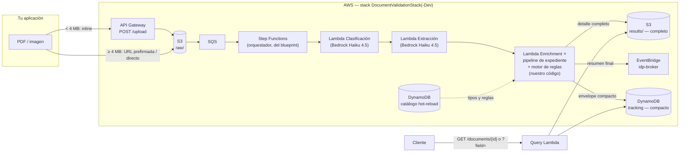
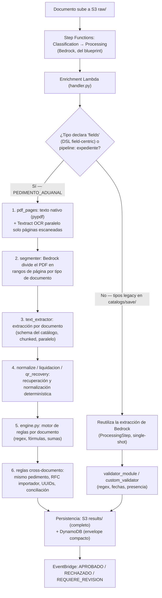

# Document Validator

Motor de validación y extracción inteligente de documentos usando Amazon Bedrock (Claude) + un motor de reglas determinístico configurable por JSON (sin tocar código, hot-reload vía DynamoDB).

El motor es genérico, pero **desde 2026-07-24 el proyecto está enfocado en expedientes aduanales mexicanos**: el único tipo de catálogo activo hoy es `PEDIMENTO_ADUANAL`, procesado con un pipeline dedicado para PDFs multi-documento (pedimento + facturas + acuses + permisos, todo en un solo archivo). Los tipos genéricos de identificación (INE, Pasaporte, CSF, CURP, NOM-35...) siguen en el repo pero **aparcados** en `catalogs/save/` — esa carpeta no la lee ni `pnpm build` ni `pnpm sync`, así que no están activos hasta que alguien los mueva de vuelta a `catalogs/`.

## Documentación

| Documento | Para qué |
|---|---|
| [`documentacion/COMO_FUNCIONA.md`](documentacion/COMO_FUNCIONA.md) | 🧭 Explicación general con diagramas — el mejor punto de partida. |
| [`documentacion/GUIA_DESPLIEGUE_Y_USO.md`](documentacion/GUIA_DESPLIEGUE_Y_USO.md) | 📘 Guía operativa completa: instalar, desplegar, subir documentos, actualizar/eliminar catálogos, troubleshooting. |
| [`documentacion/API_USO.md`](documentacion/API_USO.md) | Referencia del API REST (todos los endpoints, request/response). |
| [`documentacion/AMBIENTES_Y_SEGURIDAD.md`](documentacion/AMBIENTES_Y_SEGURIDAD.md) | dev vs. prod, dominio propio, API keys, WAF. |
| [`documentacion/TESTS.md`](documentacion/TESTS.md) | Qué comando de test correr para cada caso, costos, cómo diagnosticar un bug. |
| [`documentacion/COSTOS.md`](documentacion/COSTOS.md) | Costos reales medidos (no estimados) por página/documento/mes. |
| [`documentacion/FLUJO_EJECUCION.md`](documentacion/FLUJO_EJECUCION.md) | Recorrido del código con referencias a archivo:línea, para quien va a modificar el pipeline. |
| [`documentacion/ENVIAR_DOCUMENTO_API.md`](documentacion/ENVIAR_DOCUMENTO_API.md) | Cómo mandar un documento y leer su resultado (script o curl). |
| [`catalogs/README.md`](catalogs/README.md) | El DSL del catálogo: shape de cada campo, todas las `rule_type`, cómo crear un tipo nuevo. |
| [`AGENTS.md`](AGENTS.md) | Guía para agentes de IA trabajando en este repo (arquitectura, convenciones, comandos). |

---

## Modelo

El pipeline usa **Amazon Bedrock** con el perfil de inferencia cross-region `us.anthropic.claude-haiku-4-5-20251001-v1:0` (**Claude Haiku 4.5**) tanto para clasificar como para extraer campos — es el modelo desplegado hoy en dev y prod, verificado contra Cost Explorer (ver [`documentacion/COSTOS.md`](documentacion/COSTOS.md)). Es configurable sin tocar código vía `.env.dev`/`.env.production`:

| Variable | Para qué | Default |
|---|---|---|
| `BEDROCK_MODEL_ID` | Modelo del flujo estándar (clasificación + extracción single-shot) | `us.anthropic.claude-haiku-4-5-20251001-v1:0` |
| `BEDROCK_EXTRACTOR_MODEL_ID` | Modelo del pipeline de expediente (segmentación + extracción por documento) | igual a `BEDROCK_MODEL_ID` — se puede usar uno más fuerte solo ahí |

Cambiar el modelo requiere redeploy del ambiente correspondiente (la variable se hornea en la Lambda al desplegar).

## Arquitectura general



## Flujo de ejecución



Recorrido detallado con referencias a archivo:línea: [`documentacion/FLUJO_EJECUCION.md`](documentacion/FLUJO_EJECUCION.md). Explicación general con más diagramas: [`documentacion/COMO_FUNCIONA.md`](documentacion/COMO_FUNCIONA.md).

Características clave del pipeline de expedientes:

- **Costo-eficiente**: el texto nativo del PDF es gratis (pypdf); Textract OCR solo corre en páginas sin capa de texto. Costo real medido: ~$0.0144/página, ~$0.058 un documento de 3 páginas — ver [`documentacion/COSTOS.md`](documentacion/COSTOS.md).
- **Anti-invención**: el modelo copia valores textuales o devuelve `null`; la normalización (montos, fechas, número de pedimento, UUIDs) es determinística y nunca sustituye el valor extraído (`extractedValue` vs. `normalizedValue`).
- **Estados por campo**: `VALIDATED`, `INVALID`, `LOW_CONFIDENCE`, `NOT_FOUND`, `NOT_APPLICABLE`, `REVIEW_REQUIRED`.
- **Estados por documento/expediente**: `APPROVED`, `REJECTED`, `PARTIALLY_APPROVED`, `REVIEW_REQUIRED`, `PROCESSING_ERROR`.
- **Reglas dinámicas en JSON, sin redeploy**: `regex`, `regex_each`, `presence`, `boolean_true`, `date_expiry`, `date_max_age`, `minimum_items`, `custom_formula`, `cfdi_total`, `sum_array`, `equals_field`, `array_length`, `cross_document_match`, `cross_document_amount`, `negative_keyword`, `expected_value_by_app`, `page_ranges_no_overlap` — lista completa y semántica en [`catalogs/README.md`](catalogs/README.md).
- **Checks de expediente completo**: mismo pedimento en todos los documentos, RFC del importador consistente (ignora RFCs genéricos), CFDIs duplicados (copia legítima vs. doble cobro), conciliación de gastos y valores.

### ¿Cómo sabe el modelo dónde buscar cada campo?

Cada campo del catálogo trae un `hint` en español libre, junto a su tipo y sus reglas de validación (DSL field-centric — un solo lugar por campo, ver [`catalogs/README.md`](catalogs/README.md)):

```jsonc
"NUMERO_PEDIMENTO": {
  "type": "string",
  "required": true,
  "hint": "Número de pedimento de 15 dígitos, en el encabezado, formato AA MM PATENTE-CONSECUTIVO.",
  "validation": [{ "rule_type": "regex", "pattern": "^\\d{15}$", "message": "Debe tener 15 dígitos" }]
}
```

---

## Requisitos

- Node.js 20+, pnpm 10+ (`corepack enable`, versión pineada `pnpm@10.20.0`)
- Python 3.12+ (tests locales y bundling de la Lambda)
- AWS CLI configurado, con acceso a Amazon Bedrock (modelo `us.anthropic.claude-haiku-4-5-20251001-v1:0` en us-east-1) y Textract
- AWS CDK v2 (`npm install -g aws-cdk`, o `npx cdk` ya incluido)

## Instalación y primer despliegue

```bash
git clone <repo> && cd documents-validator
pnpm install
pnpm setup:python                     # crea .venv para tests locales
cp .env.example .env.dev              # revisa/ajusta BEDROCK_MODEL_ID, etc.

pnpm build                            # combina catalogs/ + parchea el blueprint + compila TS
pnpm run diff                         # opcional: ver qué se va a crear
pnpm run deploy                       # despliega a DEV (seguro, nunca toca prod)
```

Guía paso a paso completa (primer deploy, verificación, prod con dominio propio): [`documentacion/GUIA_DESPLIEGUE_Y_USO.md`](documentacion/GUIA_DESPLIEGUE_Y_USO.md).

## Comandos principales

```bash
pnpm build                            # catalogs/ → config/catalogs.json + patch + tsc
pnpm run deploy / deploy:dev / deploy:prod
pnpm run diff                         # cambios pendientes vs. lo desplegado
pnpm sync                             # sube TODA la carpeta catalogs/ a DynamoDB (hot-reload)
pnpm sync:one -- --type PEDIMENTO_ADUANAL   # sube un solo tipo (--dry-run para validar)
pnpm procesar -- --file mi_doc.pdf    # procesa localmente sin pasar por el stack (tus credenciales AWS)
pnpm enviar mi_doc.pdf PEDIMENTO_ADUANAL     # sube al stack desplegado
pnpm resultado -- --id <documentId>   # trae y formatea el resultado
pnpm test:unit                        # tests offline del motor de reglas ($0)
pnpm comparar -- normal_pend.pdf      # esperado vs. extraído de un documento (AWS, centavos)
pnpm test:pedimentos                  # suite completa de ground truth (AWS, ~$1)
```

Tabla completa de comandos (incluye `test:e2e:pedimento`, `schema:sensitivity`, `backfill:index`, `track`, etc.) en [`AGENTS.md`](AGENTS.md#commands) y el detalle de tests en [`documentacion/TESTS.md`](documentacion/TESTS.md).

## Catálogo de tipos documentales

La carpeta **`catalogs/`** (un archivo JSON por tipo) es la única fuente de verdad — solo se leen archivos directos de esa carpeta, ninguna subcarpeta (por eso `catalogs/save/` está inactiva). `pnpm build` la combina en el catálogo empaquetado de la Lambda; `pnpm sync`/`sync:one` la sube a DynamoDB para cambios en caliente sin redeploy (DynamoDB gana siempre sobre lo empaquetado en runtime).

Agregar un tipo nuevo:

```bash
cp catalogs/_TEMPLATE.json catalogs/MI_TIPO.json
# edita MI_TIPO.json siguiendo el DSL field-centric — ver catalogs/README.md
pnpm sync:one -- --type MI_TIPO       # inmediato (DynamoDB), o
pnpm run build && pnpm run deploy     # permanente (empaquetado)
```

Guía completa del DSL (shape de cada campo, todas las `rule_type`, campos computados, reglas cross-documento, cuándo usar `pipeline: "expediente"`): **[`catalogs/README.md`](catalogs/README.md)**.

## Estructura del proyecto

```
documents-validator/
├── bin/app.ts                              # entrypoint CDK (env dev|prod)
├── src/
│   ├── document-validation-stack.ts        # stack CDK (infraestructura)
│   ├── document-catalog.ts                 # lee catalogs/ (DSL legacy) para generar prompts
│   ├── prompt-generator.ts                 # genera prompts Bedrock del flujo estándar
│   └── document-processing/resources/
│       ├── enrichment-lambda/
│       │   ├── handler.py                  # motor de validación (NO modificar a la ligera)
│       │   ├── document_catalog.py         # carga catalogs/ empaquetado + DynamoDB
│       │   ├── config/catalogs.json        # ← GENERADO por pnpm build, no editar
│       │   ├── validators/                 # engine.py (motor de reglas) + validadores legacy
│       │   ├── pipeline/                   # pipeline de expediente: OCR, segmentación,
│       │   │                               #   extracción, normalización, liquidación, QR
│       │   ├── extractors/                 # wrappers de Textract
│       │   └── custom_validators/          # validadores Node.js (solo flujo estándar)
│       ├── upload-lambda/index.mjs         # POST /upload
│       └── query-lambda/index.mjs          # GET /documents...
├── catalogs/
│   ├── _shared.json                        # field_sets, reglas cross-documento, campos comunes
│   ├── _TEMPLATE.json                      # plantilla DSL field-centric para tipos nuevos
│   ├── PEDIMENTO_ADUANAL.json              # ← único tipo activo hoy
│   ├── save/                               # tipos legacy aparcados (no leídos por build/sync)
│   └── README.md                           # spec completa del DSL
├── scripts/                                # CLI: sync, enviar, procesar, resultado, tests, track
├── documentacion/                          # guías operativas (ver tabla arriba)
├── tests/integration/expected_pedimentos.json  # ground truth de pedimentos
└── test-docs/                              # PDFs de prueba (solo local, sin PII real en commits)
```

## Ambientes

Dos stacks aislados y completos por `-c env=dev|prod`: `DocumentValidationStack-Dev` (default, API abierta, para probar) y `DocumentValidationStack` (dominio propio + API key + WAF). Detalle: [`documentacion/AMBIENTES_Y_SEGURIDAD.md`](documentacion/AMBIENTES_Y_SEGURIDAD.md).

## Resultado de validación

Cada documento procesado produce un resultado con `validation.status` (`APROBADO`/`RECHAZADO`/`REQUIERE_REVISION`) y, para tipos aduanales, el detalle completo del expediente (documentos detectados, campos con evidencia y confianza, checks cruzados). Shape completo, incluyendo dónde vive cada nivel de detalle (DynamoDB compacto vs. S3 completo): [`documentacion/API_USO.md`](documentacion/API_USO.md).

## Autores

Luis Hernández M.

### Colaboradores
