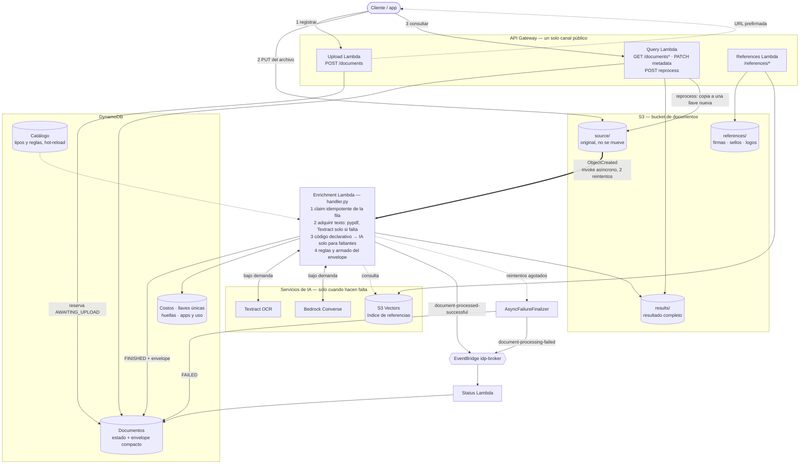

<!--
  MANTENIMIENTO: este archivo es la ÚNICA descripción de la arquitectura y el
  diagrama de abajo es el ÚNICO diagrama del repositorio. Es Mermaid en línea:
  se edita aquí mismo y GitHub/VS Code lo renderizan, sin PNG que regenerar.

  Si cambias infraestructura (`src/document-validation-stack.ts`,
  `src/document-processing/multi-model-document-processing.ts`) o el
  enrutamiento de `handler.py`, actualiza ESTE archivo en el mismo cambio. Los
  demás documentos enlazan aquí en vez de repetir el flujo: no agregues otro
  diagrama de arquitectura en otro lugar.
-->

# Arquitectura

Qué infraestructura existe, por dónde pasa un documento y qué decide cada
pieza. Para la explicación conceptual sin código ver
[`COMO_FUNCIONA.md`](COMO_FUNCIONA.md).

## Diagrama

No hay cola SQS, Step Functions ni Lambdas de clasificación/extracción previas:
S3 invoca a la Enrichment Lambda directamente.

Durante la migración a otra cuenta, el primer despliegue CDK usa
`MIGRATION_PAUSE_INGRESS=1`: crea el bucket y las tablas de destino sin
notificaciones S3 para cargar los objetos históricos. Después de restaurarlos,
el despliegue de activación agrega las notificaciones `source/` y `raw/` a ese
mismo bucket. Fuera de esa fase, el ingreso directo del diagrama está activo.
La secuencia operativa está en [la guía de migración](GUIA_MIGRACION_CUENTA_AWS.md).

## Recorrido de un documento

1. **Registrar.** `POST /documents` valida el request, reserva el `documentId`
   en DynamoDB (`ProcessingStatus=AWAITING_UPLOAD`, `SourceKey`) y devuelve una
   URL prefirmada. El archivo nunca pasa por API Gateway, sea del tamaño que sea.
2. **Subir.** El cliente hace `PUT` a `source/{TIPOS?}/{documentId}/{archivo}`.
   Los tipos declarados viajan como un solo segmento de la llave
   (`source/{A,B}/…`); sin segmento de tipo, la clasificación es automática.
3. **Disparo.** El `ObjectCreated` de `source/` invoca a la Enrichment Lambda.
   `raw/` sigue aceptado solo por URLs prefirmadas emitidas antes del ingreso
   directo. `results/` y `references/` no tienen notificación: escribir un
   resultado no puede disparar otro procesamiento.
4. **Claim.** S3 entrega al menos una vez, así que la Lambda toma la fila con
   una escritura condicional (`handler._claim_direct_event`): un documento
   terminado no se reprocesa, una entrega duplicada se ignora mientras la lease
   siga viva, y un reintento asíncrono (mismo request id de Lambda) retoma el
   claim de un intento que murió sin liberarlo.
5. **Extracción.** Según el archivo: PDF/imagen → `pipeline/expediente.py`;
   XML → `pipeline/xml_document.py`; XLSX/CSV → `pipeline/tabular_document.py`.
   La regla de producto es *texto barato → código declarativo → IA solo para lo
   que falte → envelope armado y validado por código* (detalle abajo).
6. **Persistencia.** Resultado completo en `results/{documentId}.json`;
   envelope compacto, `FINISHED` e índices en DynamoDB; costo y llaves únicas en
   sus tablas (las tres escrituras auxiliares van en paralelo).
7. **Evento.** `document-processed-successful` en EventBridge. Si el resultado
   se guardó pero el evento falló, el siguiente intento solo republica.
8. **Falla técnica.** Una excepción o timeout se reintenta dos veces; agotados
   los reintentos, `AsyncFailureFinalizer` marca `FAILED` (nunca sobre un
   documento ya completo) y publica `document-processing-failed`.
9. **Consulta.** `GET /documents/{id}` devuelve estado y resultado;
   `GET /documents/{id}/file` resuelve el original por `SourceKey`.

Un `RECHAZADO` es un resultado de negocio, no una falla: la ejecución termina
`FINISHED` con `validation.status=RECHAZADO`.

## Dentro de la Enrichment Lambda (PDF/imagen)

| Paso | Módulo | Qué hace |
| --- | --- | --- |
| Texto | `pdf_pages.py`, `text_acquisition.py` | Texto nativo con pypdf (gratis); Textract OCR solo en páginas sin capa de texto. Un tipo puede diferir el OCR hasta saber que el código no bastó (`text_acquisition.ocr_mode`, kill switch `DEFERRED_OCR_ENABLED`). |
| Segmentación | `segmenter.py` | Con un tipo declarado, un solo segmento sin llamar al modelo; si no, Bedrock clasifica rangos de páginas. |
| Selección de páginas | `page_selector.py` | Opt-in por tipo (`page_selection`): recorta a las páginas con los marcadores del tipo antes de extraer; fail-open si nada califica. |
| Extracción | `deterministic_text.py`, `text_extractor.py` | Patrones declarados en el catálogo resuelven lo que pueden; solo las ramas faltantes van a Bedrock, con respuesta compacta. Modos y rollback: [`MODOS_EXTRACCION.md`](MODOS_EXTRACCION.md), [`EXTRACCION_DETERMINISTICA_E_HIBRIDA.md`](EXTRACCION_DETERMINISTICA_E_HIBRIDA.md). |
| Autenticidad | `authenticity.py` | Opt-in por tipo: integridad del archivo, estructura del PDF, pixeles, visión y memoria. Guía: [`AUTENTICIDAD_Y_REFERENCIAS.md`](AUTENTICIDAD_Y_REFERENCIAS.md). |
| Normalización y reglas | `normalize.py`, `qr_recovery.py`, `derived.py`, `validators/engine.py` | Recuperación por regex/QR, campos derivados, y el motor de reglas que decide el estado de cada campo y documento. |
| Reglas entre documentos | `expediente.py` | Mismo pedimento, RFC, UUIDs únicos, conciliación de importes. |
| Envelope | `envelope.py` | `documents[]` siempre presente, recortado a presupuesto; el detalle completo vive en `results/`. |

XML y tabulares son código puro: cero Bedrock, cero Textract.

## Componentes

| Pieza | Rol |
| --- | --- |
| **Upload Lambda** | `POST /documents`: valida, aplica el tope diario por app, reserva el id y firma el `PUT`. |
| **Enrichment Lambda** | Todo el procesamiento (`handler.py` + `pipeline/` + `validators/`). 15 min, 1536 MB. |
| **AsyncFailureFinalizer** | Destino de falla del invoke asíncrono: `FAILED` + evento. |
| **Status Lambda** | Proyecta los eventos terminales al ciclo público `FINISHED`/`FAILED`; Enrichment ya escribe el estado, esto mantiene el contrato para otros productores. |
| **Query Lambda** | Lectura, búsqueda, `PATCH` de metadata y reprocess (copia el original a una llave `source/` nueva con id nuevo). Aplica el alcance por app. |
| **References Lambda** | Mismo asset que Enrichment con otro handler; registra y consulta firmas/sellos/logos de referencia. |
| **S3 documentos** | `source/` (originales), `results/` (resultados completos), `references/` (imágenes de referencia). `raw/`, `processed/` y `failed/` son históricos: Query los usa como fallback para filas sin `SourceKey`. |
| **DynamoDB documentos** | Ciclo `AWAITING_UPLOAD → PROCESSING → FINISHED`/`FAILED`, envelope compacto, `Metadata` mutable, columnas indexadas por tipo. |
| **DynamoDB catálogo** | Tipos y reglas editables en caliente (`pnpm sync`), `RETAIN`; gana sobre el JSON empaquetado. |
| **DynamoDB auxiliares** | Costos por documento, llaves únicas, huellas de autenticidad, apps y uso diario. |
| **S3 Vectors** | Índice derivado de referencias (Titan Multimodal, 1024 dim); `pnpm refs:reindex` lo reconstruye. |
| **EventBridge `idp-broker`** | Notificación terminal con el id; el resultado se consulta por id. |
| **KMS** | En prod un CMK compartido cifra todo el pipeline; dev usa cifrado administrado por cada servicio. |

Dev y prod son dos stacks completos y aislados; WAF, dominio propio y API keys
obligatorias solo en prod. Detalle en
[`AMBIENTES_Y_SEGURIDAD.md`](AMBIENTES_Y_SEGURIDAD.md). Los logical IDs del
bucket y la tabla están fijados por `scripts/check-infra-migration.mjs`, que
bloquea un deploy que intentara reemplazarlos.

## Modelos

Todas las llamadas usan Bedrock **Converse**, agnóstica del proveedor; cada
etapa puede usar un modelo distinto vía `.env.dev`/`.env.production` (requiere
redeploy y tener habilitado el "Model access" de esa familia).

| Variable | Etapa | ¿Visión? |
| --- | --- | --- |
| `BEDROCK_MODEL_ID` | Modelo base de todas las etapas | — |
| `BEDROCK_SEGMENTER_MODEL_ID` | Segmentación | No |
| `BEDROCK_EXTRACTOR_MODEL_ID` | Extracción (la mayor parte de los tokens) | No |
| `BEDROCK_RECOVERY_MODEL_ID` | Re-extracción Textract + modelo | No |
| `BEDROCK_VISION_MODEL_ID` | Autenticidad física | **Sí** — nunca hereda el modelo base |

La extracción corre siempre sobre texto, así que admite modelos sin visión. Qué
exige cada etapa de un modelo (tool use forzado, prompt caching, visión) y qué
se probó: [`MODELOS_TEXTO.md`](MODELOS_TEXTO.md),
[`MODELOS_VISION.md`](MODELOS_VISION.md). Costos: [`COSTOS.md`](COSTOS.md).
Latencia medida por tramo: [`LATENCIA.md`](LATENCIA.md).
