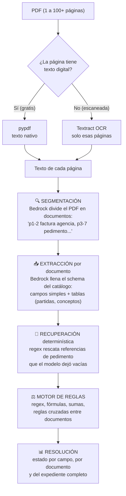
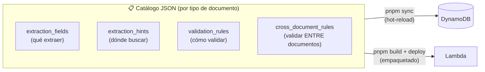
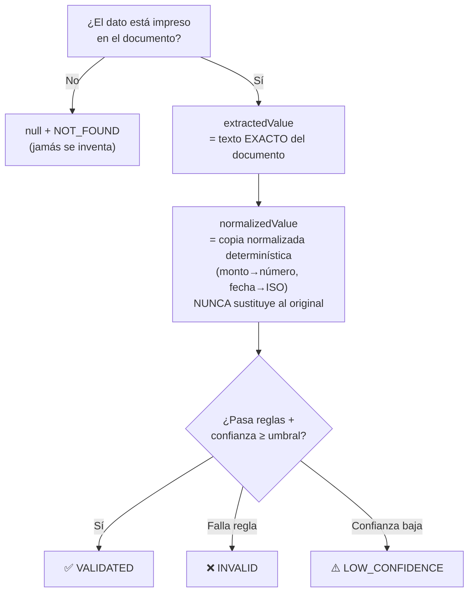
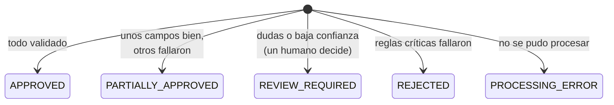
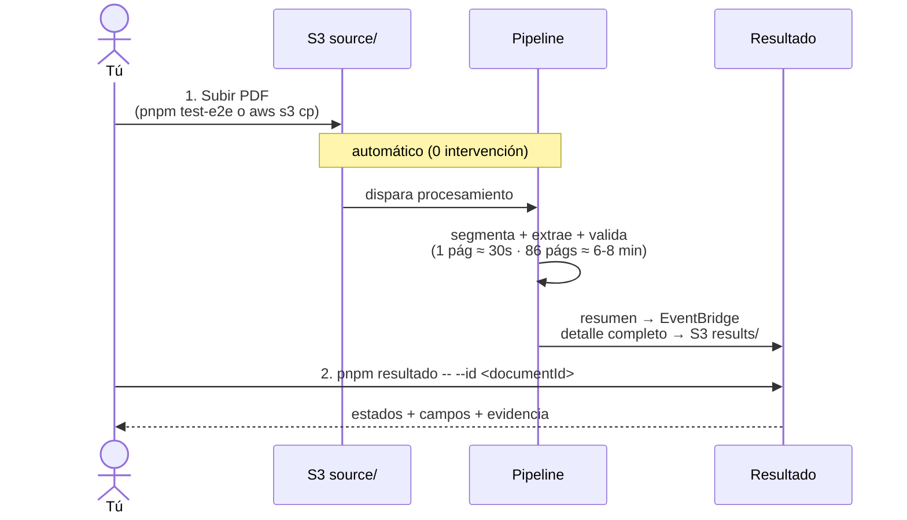

# ¿Cómo funciona Document Validator? — Explicación general (high level)

Documento para entender el sistema completo sin leer código: qué hace, cómo fluye un documento, cómo decide si algo es válido y cómo se usa.

---

## 1. ¿Qué hace el sistema en una frase?

> Recibe un PDF (un CFDI, un pedimento o un expediente aduanal completo de decenas de páginas), **encuentra qué documentos contiene, extrae sus campos, los valida con reglas configurables** y devuelve un resultado con evidencia y nivel de confianza — **sin inventar jamás un dato que no esté en el documento**.

---

## 2. Arquitectura general

Todo es serverless en AWS, sin servidores que administrar: el archivo se sube a
S3 y eso invoca directamente a la Lambda que lo procesa; el resultado queda en
DynamoDB/S3 y se avisa por EventBridge. El diagrama y el detalle de cada pieza
viven en un solo lugar: [`ARQUITECTURA.md`](ARQUITECTURA.md).

---

## 3. El pipeline de expedientes (el corazón del sistema)

Un "expediente" aduanal es UN PDF con MUCHOS documentos adentro (pedimento + facturas + acuses + permisos...). El pipeline lo desarma y procesa cada uno:



**Ejemplo real** (`pedimentos.pdf`, 86 páginas): el sistema detectó 23 documentos — factura de la agencia aduanal, 3 copias del pedimento, factura del proveedor extranjero, CFDIs de terceros, comprobantes de pago SPEI, acuses VUCEM — y validó que **todos pertenecen al mismo pedimento `260734356041248`** y al mismo importador.

### ¿Por qué es costo-eficiente?

| Recurso | Expediente de 86 páginas | Costo |
|---|---|---|
| pypdf (texto nativo) | 68 páginas digitales | **$0.00** — es gratis |
| Textract OCR | solo las 18 páginas escaneadas | ~$0.03 |
| Bedrock Haiku 4.5 (segmentar + extraer; con Haiku 5.5 es ~10x menos por token) | todo el texto | ~$0.32 |
| **Total** | | **~$0.35 USD** |

- El texto de PDFs digitales es **gratis** (pypdf); Textract solo toca páginas escaneadas — subir PDFs digitales en vez de escaneos reduce ~10x el costo.
- Un CFDI de 1 página cuesta ~$0.02.

---

## 4. El motor de reglas (validación configurable)

Las reglas viven en la carpeta **`catalogs/`** (un JSON por tipo) — se agregan o cambian **sin tocar código ni redesplegar**:



**Tipos de regla disponibles** (todas en JSON):

| Categoría | Reglas | Ejemplo |
|---|---|---|
| Formato | `regex`, `regex_each`, `presence` | RFC válido, pedimento de 15 dígitos |
| Fechas | `date_expiry`, `date_max_age` | permiso no vencido |
| Matemáticas | `custom_formula`, `cfdi_total`, `sum_array` | subtotal + IVA = total (con tolerancia) |
| Entre documentos | `cross_document_match`, `cross_document_amount` | el CFDI referencia al pedimento del expediente |
| Negocio | `expected_value_by_app`, `negative_keyword`, `minimum_items` | el RFC receptor es TU empresa |

**Reglas de expediente completo** (automáticas): mismo pedimento en todos los documentos, RFC del importador consistente, CFDIs duplicados (distingue copia legítima de doble cobro), conciliación de gastos vs. cuenta del agente.

---

## 5. Estados y política anti-invención

### El principio nº 1: nunca entregar un dato inventado como válido



### Estados por campo

`VALIDATED` · `INVALID` · `LOW_CONFIDENCE` · `NOT_FOUND` · `NOT_APPLICABLE` · `REVIEW_REQUIRED`

### Estados por documento y expediente



> El sistema es **conservador a propósito**: ante la duda marca `REVIEW_REQUIRED` en vez de aprobar. Un dato dudoso nunca sale como bueno.

### Cada campo devuelve evidencia completa

```json
{
  "extractedValue": "26 07 3435 6041248",
  "normalizedValue": "260734356041248",
  "status": "VALIDATED",
  "confidence": 0.98,
  "checks": [
    { "rule": "presence", "valid": true },
    { "rule": "regex", "valid": true, "message": "15 dígitos" }
  ]
}
```

---

## 6. Flujo de uso completo (lo que haces tú)



### Comandos del día a día

| Quiero… | Comando |
|---|---|
| Subir un documento (<4 MB) | `pnpm test-e2e --file doc.pdf --no-wait` |
| Subir uno grande (≥4 MB) | `aws s3 cp doc.pdf s3://<bucket>/raw/$(uuidgen)/doc.pdf` |
| Ver el resultado | `pnpm resultado -- --id <documentId> --wait` |
| Probar local sin el stack | `pnpm procesar -- doc.pdf --importer MI_RFC` |
| Cambiar reglas sin redeploy | editar el tipo bajo `catalogs/base/` o `catalogs/custom/` + `pnpm sync` |
| Crear un tipo nuevo | copiar `catalogs/_TEMPLATE.json` → `catalogs/base/<dominio>/<TIPO>.json` o `catalogs/custom/<integración>/<TIPO>.json` + `pnpm sync:one` |
| Desplegar cambios de código | `pnpm build && pnpm run deploy` |

---

## 7. Ejemplo real: ¿dónde queda mi número de pedimento?

Procesando `pedimentos.pdf` (86 páginas), el número `260734356041248` queda en:

```
resultado
└── expediente
    └── documents[]
        └── { documentType: "PEDIMENTO_ADUANAL", pageStart: 3, pageEnd: 7 }
            └── fields
                └── NUMERO_PEDIMENTO_NORMALIZADO
                    ├── extractedValue:  "260734356041248"
                    ├── normalizedValue: "260734356041248"
                    ├── status:          "VALIDATED"     ← úsalo solo si dice esto
                    └── confidence:      0.98
```

Tu aplicación consumidora: busca el documento con `documentType == "PEDIMENTO_ADUANAL"` y lee `fields.NUMERO_PEDIMENTO_NORMALIZADO.normalizedValue` **solo cuando `status == "VALIDATED"`**.

---

## 8. Mapa de archivos del proyecto

```
documents-validator/
├── catalogs/                          ← ⭐ TUS REGLAS (un JSON por tipo, fuente de verdad)
├── src/
│   ├── document-validation-stack.ts      ← infraestructura (CDK)
│   └── document-processing/resources/enrichment-lambda/
│       ├── pipeline/                     ← pipeline de expedientes (OCR, segmentar, extraer)
│       ├── validators/engine.py          ← motor de reglas dinámico
│       └── config/catalogs.json        ← copia generada del catálogo (NO editar)
├── scripts/                              ← CLI: subir, procesar, ver resultado, catálogo
├── tests/                                ← tests unitarios (enfocados en PEDIMENTO_ADUANAL) + integración con docs reales
└── documentacion/
    ├── COMO_FUNCIONA.md                  ← este documento
    └── GUIA_DESPLIEGUE_Y_USO.md          ← guía operativa paso a paso
```

---

## 9. Límites y decisiones conocidas

| Tema | Situación |
|---|---|
| Archivos por API | Sin tope de tamaño real: `POST /documents` devuelve una URL prefirmada y el archivo va con un `PUT` directo a S3, nunca por API Gateway/Lambda. Mismos dos pasos para cualquier tamaño |
| Páginas por documento (expedientes/pedimentos) | **Si el tipo declarado selecciona sus páginas** (`page_selection`): no se trunca — el costo lo acota el selector, con un tope de salvaguarda muy superior (`max_source_pages`, 500). **Si no** (tipo sin selección, apagada, o subida sin tipo declarado): máximo 50 (`MAX_PAGES`, configurable); el excedente se trunca antes de correr Textract/Bedrock para acotar costo — el original completo queda intacto en S3, resultado marcado `reviewRequired` + `truncated` |
| Tiempo | 1 página ≈ 30 s · 27 págs escaneadas ≈ 4 min · 86 págs ≈ 6-8 min (límite Lambda: 15 min) |
| Páginas `OTRO` | COVE, DODA, SPEI internos no tienen tipo en el catálogo → `REVIEW_REQUIRED` (agregables vía JSON) |
| Reglas cross-documento | Solo viven en el JSON empaquetado (cambiarlas requiere `pnpm build && pnpm run deploy`) |
| Precisión | Ningún modelo garantiza 0 errores; por eso: confianza por campo + reglas determinísticas + abstención (`NOT_FOUND`) + revisión humana |
```
