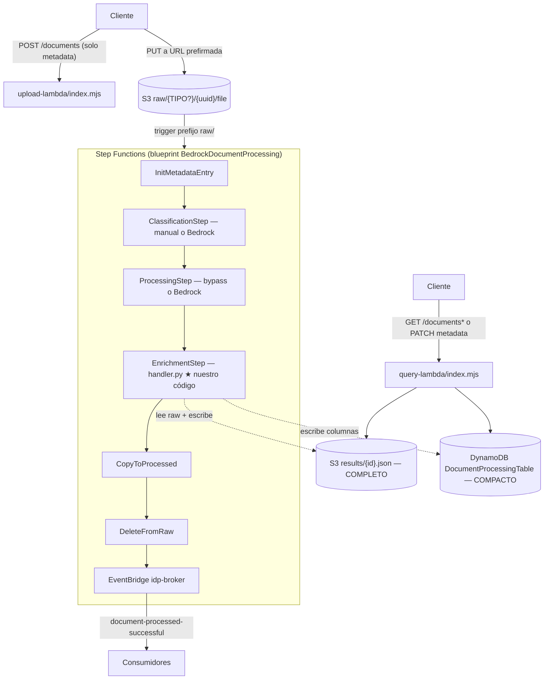

# Flujo de ejecución — de un documento a su resultado

Recorrido de alto nivel del código que atraviesa un documento, desde que se
sube hasta que su resultado queda consultable. Al final: **oportunidades de
mejora del dataflow**.

> Para seguir la ejecución función por función, con rangos de líneas, payloads
> y llamadas AWS exactas, consulta [`TRAZA_CODIGO_COMPLETA.md`](TRAZA_CODIGO_COMPLETA.md).

## Vista de 10,000 pies



Puntos clave:
- La **Step Function la crea el blueprint** (`@cdklabs/cdk-appmod-catalog-blueprints`); este repo aporta el paso de **enrichment**, upload/query y las Lambdas que sustituyen clasificación/procesamiento del modelo.
- En las rutas field-centric/XML/tabular el resultado se guarda en **dos lugares**: DynamoDB (envelope compacto, límite 256 KB de Step Functions) y S3 (`results/{id}.json`, completo). El flujo legacy solo persiste el envelope. Ver `API_USO.md`.

## Recorrido paso a paso (con referencias a código)

### 1. Subida
- `upload-lambda/index.mjs:handler` — valida, y escribe a `raw/{TIPO}/{uuid}/file`
  si el usuario declaró `documentType`, o `raw/{uuid}/file` si no. El **prefijo
  con tipo** es cómo el usuario "fuerza" la clasificación.
- **Un solo flujo, dos pasos, para cualquier tamaño:** `POST /documents` lleva solo
  metadata y devuelve una URL prefirmada de S3 (`uploadUrl`);
  el cliente sube con `PUT` directo a esa URL. El archivo nunca pasa por API
  Gateway ni por la Lambda, así que no hay tope de tamaño real ni una rama por
  tamaño que se pueda equivocar. El modo inline (`contentBase64`) fue eliminado.

### 2. Orquestación (blueprint, sin código nuestro)
- Trigger S3 sobre `raw/` → Step Functions.
- `InitMetadataEntry` → crea el registro en DynamoDB (`WorkflowStatus=pending`).
- `ClassificationStep` → acepta el tipo declarado sin IA o usa Bedrock si debe clasificar.
- `ProcessingStep` → extrae entidades legacy con Bedrock o hace bypass para tipos field-centric y documentos grandes.
- Cada paso actualiza DynamoDB (`ClassificationResult`, `ProcessingResult`).

### 3. Enrichment — `handler.py:handler` (★ el corazón)
Entra el evento con `documentId`, `content` (puntero S3), `classificationResult`,
`processingResult`. Bifurca:

```
handler()  handler.py:715
└── _process()  handler.py:743
    ├── ¿pipeline expediente, event.expediente o field_tree?
    │   └── SÍ → _run_expediente()  ────────────► CAMINO A (expediente)
    └── NO → flujo estándar de un documento  ───► CAMINO B (clásico)
```

#### CAMINO A — Expediente (pedimentos / multi-documento)
`_run_expediente` (`handler.py:437`) → `pipeline/expediente.py:process_pdf`:

1. **`load_pages`** (`pipeline/pdf_pages.py:165`) — texto por página:
   texto nativo con pypdf (modo *layout*); para páginas escaneadas, **Textract
   OCR en paralelo** (`ThreadPoolExecutor`, `pdf_pages.py:165-194`).
2. **`segment_pages`** (`pipeline/segmenter.py`) — parte el PDF en rangos tipados.
   Si hay `declared_type` (usuario forzó), **un solo segmento sin llamar al modelo**;
   si no, una llamada Bedrock clasifica los rangos de página.
3. **Extracción paralela por segmento** (`expediente.py:174-371`) — cada worker
   llama `text_extractor.extract_document` (Bedrock con el schema del catálogo,
   troceado por páginas), luego recuperación y normalización deterministas.
4. **Validación por documento** (`expediente.py:_extract_segment`) — `engine.run_rules` +
   `resolve_fields` + `document_status` (reglas del catálogo).
5. **Reglas cross-documento** (`expediente.py:_run_cross_document_rules`) —
   mismo pedimento, RFC importador, UUIDs únicos, reconciliación de gastos/valores.
6. **Ensamblado + `tracking`** (versión, tiempos, esquema).
7. **Persistencia**: escribe el resultado **completo** a `results/{id}.json` en S3
   (`handler.py:514-530`) y devuelve un **envelope compacto**
   (`_compact_expediente`) para caber en el payload de Step Functions.

#### CAMINO B — Clásico (DSL legacy; sus catálogos están aparcados)
Un solo documento; **reutiliza** la extracción de `ProcessingStep`:
1. `entities_to_map(processingResult)` (`handler.py:55`).
2. `_run_validation` con el `validator_module` del tipo.
3. Fallback opcional Textract si el tipo lo pide y hubo fallas estructurales
   (`handler.py:287`, `_try_reextract`).
4. Validador custom Node.js opcional.
5. `build_canonical_result`.

### 4. Salida
- DynamoDB: envelope compacto en `EnrichmentResult`; `WorkflowStatus=complete`.
- S3: resultado completo (`results/{id}.json`) para rutas field-centric/XML/tabular.
- EventBridge: notificación `document-processed-successful` (broker `idp-broker`); el resultado se consulta por id.

### 5. Consulta — `query-lambda/index.mjs`
- `GET /documents/{id}` → envelope de DynamoDB (`+ fullResult` de S3 con `full=1`).
- `GET /documents?docType=...` → Query al GSI; sin tipo, la búsqueda profunda puede caer en Scan.
- `PATCH /documents/{id}/metadata` → merge patch en la columna `Metadata`
  con versión optimista. La API la superpone en GET/filtros, pero no cambia
  `validation.status`, EventBridge ni el snapshot histórico de S3.

## Dónde vive el dato en cada etapa (dataflow)

| Etapa | Entrada | Salida | Dónde queda |
|---|---|---|---|
| Upload | archivo | objeto S3 `raw/` | S3 |
| Classification | S3 raw | `documentClassification` | DynamoDB `ClassificationResult` |
| Processing | S3 raw | entidades legacy o bypass | DynamoDB `ProcessingResult` |
| Enrichment A | S3 raw | expediente validado | S3 `results/` (full) + DynamoDB (compacto) |
| Enrichment B | `ProcessingResult` | canonical result | DynamoDB |
| Consulta/metadata | id / filtros / merge patch | envelope / matches / metadata actual | `Metadata` mutable en DynamoDB; resultados históricos intactos |

## Oportunidades de mejora del dataflow

Ordenadas por impacto (⭐ = mayor).

1. **⭐⭐⭐ Usage upstream no llega a la auditoría.** Las Lambdas de
   clasificación/procesamiento retornan tokens, pero sus `resultSelector` no
   propagan `usage`; esas líneas del cost audit quedan en cero.

2. **⭐⭐ Consulta por Scan completo.** `query-lambda` escanea toda la tabla y
   filtra en la Lambda (el dato buscable vive dentro del JSON de `EnrichmentResult`).
   Bien para pocos docs; a escala, promover campos "calientes"
   (`NUMERO_PEDIMENTO_NORMALIZADO`, RFC) a atributos + **GSI** para O(1).

3. **⭐⭐ Scan del catálogo en cada invocación.** `forceReloadCatalog` garantiza
   hot reload inmediato, pero agrega una lectura paginada a cada documento.

4. **⭐ Doble representación del resultado.** El resultado crudo de `process_pdf`
   (sin wrapper) va a S3 y el envelope (con `expediente`) a DynamoDB — dos shapes
   distintos que confunden a los consumidores (ver `API_USO.md`). *Mejora:*
   unificar el shape entre S3 y DynamoDB.

5. **⭐ Escrituras finales parcialmente independientes.** S3 full, columnas
   indexadas, CostTable y `EnrichmentResult` no son una transacción. Conviene
   definir reconciliación/idempotencia si alguna escritura falla.

6. **Concurrencia anidada.** OCR, segmentos y chunks ya están paralelizados;
   ajustar simultáneamente sus tres worker pools puede provocar throttling.

7. **Expedientes > 15 min.** Un PDF enorme todavía puede topar el límite de la
   Lambda y requerir fan-out/asíncrono.

> La explicación y los puntos de intervención exactos están en las secciones 25
> y 26 de `TRAZA_CODIGO_COMPLETA.md`.
