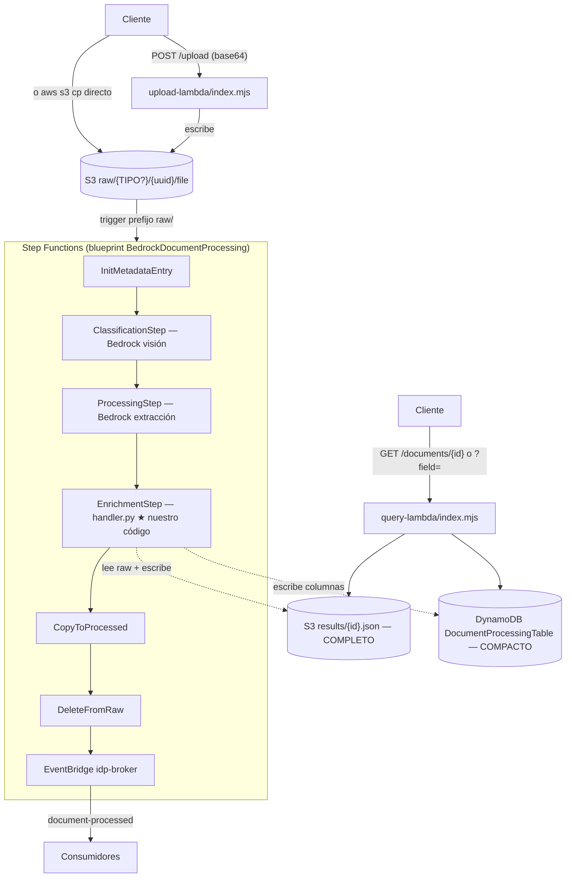

# Flujo de ejecución — de un documento a su resultado

Recorrido de alto nivel del código que atraviesa un documento, desde que se
sube hasta que su resultado queda consultable. Al final: **oportunidades de
mejora del dataflow**.

## Vista de 10,000 pies



Puntos clave:
- La **Step Function la crea el blueprint** (`@cdklabs/cdk-appmod-catalog-blueprints`); nosotros solo aportamos el paso de **enrichment** (`handler.py`) y las Lambdas de upload/query.
- El resultado se guarda en **dos lugares**: DynamoDB (envelope compacto, límite 256 KB de Step Functions) y S3 (`results/{id}.json`, completo). Ver `API_USO.md`.

## Recorrido paso a paso (con referencias a código)

### 1. Subida
- `upload-lambda/index.mjs:handler` — valida, y escribe a `raw/{TIPO}/{uuid}/file`
  si el usuario declaró `documentType`, o `raw/{uuid}/file` si no. El **prefijo
  con tipo** es cómo el usuario "fuerza" la clasificación.
- Archivos chicos (~4 MB): body con `contentBase64`, la Lambda decodifica y
  escribe a S3 ella misma. Archivos grandes: `POST /upload` sin
  `contentBase64` devuelve una URL prefirmada de S3; el cliente sube con
  `PUT` directo a esa URL — sin tope de tamaño real, sin pasar por Lambda.

### 2. Orquestación (blueprint, sin código nuestro)
- Trigger S3 sobre `raw/` → Step Functions.
- `InitMetadataEntry` → crea el registro en DynamoDB (`WorkflowStatus=pending`).
- `ClassificationStep` → Bedrock decide el `documentClassification`.
- `ProcessingStep` → Bedrock extrae entidades (single-shot).
- Cada paso actualiza DynamoDB (`ClassificationResult`, `ProcessingResult`).

### 3. Enrichment — `handler.py:handler` (★ el corazón)
Entra el evento con `documentId`, `content` (puntero S3), `classificationResult`,
`processingResult`. Bifurca:

```
handler()  handler.py:490
├── ¿is_customs_type(classification) o event.expediente?   handler.py:521
│     └── SÍ → _run_expediente()  ──────────────► CAMINO A (expediente)
└── NO → flujo estándar de un documento  ───────► CAMINO B (clásico)
```

#### CAMINO A — Expediente (pedimentos / multi-documento)
`_run_expediente` (`handler.py:342`) → `pipeline/expediente.py:process_pdf`:

1. **`load_pages`** (`pipeline/pdf_pages.py:102`) — texto por página:
   texto nativo con pypdf (modo *layout*); para páginas escaneadas, **Textract
   OCR en paralelo** (`ThreadPoolExecutor`, `pdf_pages.py:119`).
2. **`segment_pages`** (`pipeline/segmenter.py`) — parte el PDF en rangos tipados.
   Si hay `declared_type` (usuario forzó), **un solo segmento sin llamar al modelo**;
   si no, una llamada Bedrock clasifica los rangos de página.
3. **Extracción por segmento** (`expediente.py:135`, bucle `for seg in segments`) —
   por cada documento: `text_extractor.extract_document` (Bedrock con el schema del
   catálogo, troceado por páginas), luego `_recover_references` (regex de pedimento)
   y `build_liquidacion_normalizada` (normaliza el cuadro).
4. **Validación por documento** (`expediente.py:177`) — `engine.run_rules` +
   `resolve_fields` + `document_status` (reglas del catálogo).
5. **Reglas cross-documento** (`expediente.py:_run_cross_document_rules`) —
   mismo pedimento, RFC importador, UUIDs únicos, reconciliación de gastos/valores.
6. **Ensamblado + `tracking`** (versión, tiempos, esquema).
7. **Persistencia**: escribe el resultado **completo** a `results/{id}.json` en S3
   (`handler.py:379`) y devuelve un **envelope compacto** (`_compact_expediente`,
   `handler.py:425`) para caber en el payload de Step Functions.

#### CAMINO B — Clásico (INE, CSF, etc.)
Un solo documento; **reutiliza** la extracción de `ProcessingStep`:
1. `entities_to_map(processingResult)` (`handler.py:528`).
2. `_run_validation` con el `validator_module` del tipo.
3. Fallback opcional Textract si el tipo lo pide y hubo fallas estructurales
   (`handler.py:538`, `_try_reextract`).
4. Validador custom Node.js opcional.
5. `build_canonical_result`.

### 4. Salida
- DynamoDB: envelope compacto en `EnrichmentResult`; `WorkflowStatus=complete`.
- S3: resultado completo (`results/{id}.json`).
- EventBridge: evento `document-processed` (broker `idp-broker`).

### 5. Consulta — `query-lambda/index.mjs`
- `GET /documents/{id}` → envelope de DynamoDB (`+ fullResult` de S3 con `full=1`).
- `GET /documents?field=&value=` → **Scan** de la tabla + filtro por dot-path.

## Dónde vive el dato en cada etapa (dataflow)

| Etapa | Entrada | Salida | Dónde queda |
|---|---|---|---|
| Upload | archivo | objeto S3 `raw/` | S3 |
| Classification | S3 raw | `documentClassification` | DynamoDB `ClassificationResult` |
| Processing | S3 raw | entidades (single-shot) | DynamoDB `ProcessingResult` |
| Enrichment A | S3 raw | expediente validado | S3 `results/` (full) + DynamoDB (compacto) |
| Enrichment B | `ProcessingResult` | canonical result | DynamoDB |
| Consulta | id / campo | envelope / matches | — |

## Oportunidades de mejora del dataflow

Ordenadas por impacto (⭐ = mayor).

1. **⭐⭐⭐ Trabajo Bedrock desperdiciado para customs.** El blueprint corre
   `ClassificationStep` + `ProcessingStep` (2 llamadas Bedrock) **antes** del
   enrichment, pero para tipos aduanales el handler **ignora ambas**: el
   segmenter re-clasifica y `text_extractor` re-extrae. Son 2 llamadas Bedrock
   por documento tiradas a la basura (costo + latencia). *Mejora:* saltar
   Classification/Processing cuando el prefijo `raw/{TIPO}/` ya declara un tipo
   `pipeline=expediente`, o hacer esos pasos "no-op" para customs.

2. **⭐⭐⭐ Extracción por-segmento secuencial.** En `expediente.py:135` los
   segmentos se extraen uno por uno (cada uno ≥1 llamada Bedrock). Un expediente
   de 17 documentos = 17 llamadas en serie (medimos ~222 s). *Mejora:*
   paralelizar con `ThreadPoolExecutor` (como ya se hace el OCR en `pdf_pages`);
   podría bajar de minutos a ~decenas de segundos. Es el mayor cuello de botella
   de latencia.

3. **⭐⭐ Chunks de un documento largo, secuenciales.** `text_extractor.py:187`
   llama al modelo por chunk en serie. Paralelizable igual que arriba.

4. **⭐⭐ Consulta por Scan completo.** `query-lambda` escanea toda la tabla y
   filtra en la Lambda (el dato buscable vive dentro del JSON de `EnrichmentResult`).
   Bien para pocos docs; a escala, promover campos "calientes"
   (`NUMERO_PEDIMENTO_NORMALIZADO`, RFC) a atributos + **GSI** para O(1).

5. **⭐ Reglas cross-documento no hot-reloadables.** Solo viven en el JSON
   empaquetado (`_shared.json`), no en DynamoDB, así que cambiarlas exige redeploy.
   *Mejora:* cargarlas también desde DynamoDB.

6. **⭐ Doble representación del resultado.** El resultado crudo de `process_pdf`
   (sin wrapper) va a S3 y el envelope (con `expediente`) a DynamoDB — dos shapes
   distintos que confunden a los consumidores (ver `API_USO.md`). *Mejora:*
   unificar el shape entre S3 y DynamoDB.

7. **Expedientes > 15 min.** Un PDF enorme puede topar el límite de la Lambda.
   Con el punto (2) resuelto se mitiga; si no, mover a ejecución asíncrona.

> Nota: el OCR de Textract **ya** está paralelizado (`pdf_pages.py:119`), así que
> no es un cuello de botella — el costo está en las llamadas Bedrock secuenciales.
