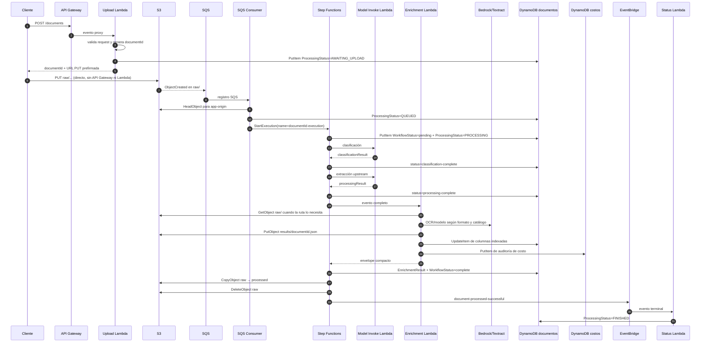
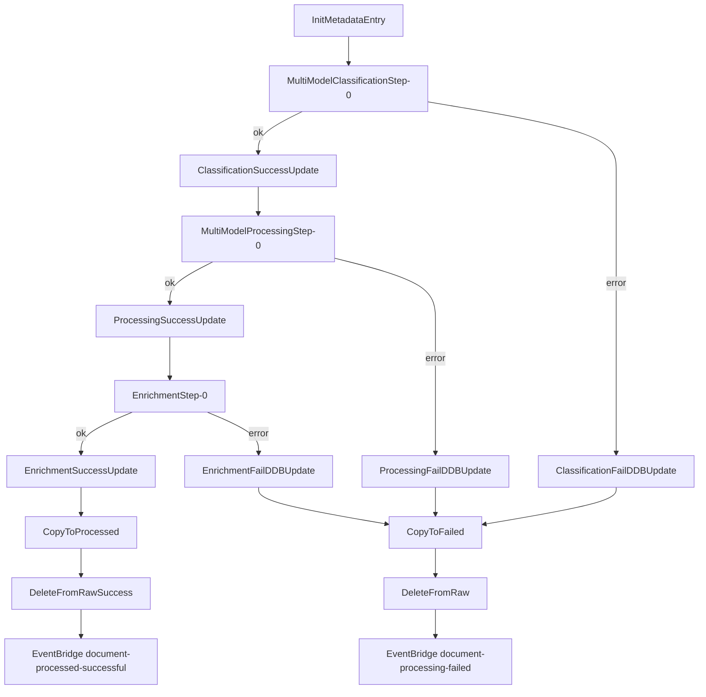

# Traza completa del código — desde la carga hasta el documento procesado

Este documento sigue una ejecución real de punta a punta. Su objetivo es que una
persona pueda abrir el repositorio, poner un breakpoint o buscar un log y saber
qué función corre después, qué datos recibe, qué escribe y qué condición cambia
el camino.

La fuente de verdad de la orquestación es una combinación de:

- `src/document-validation-stack.ts`, que conecta la infraestructura propia;
- `src/document-processing/multi-model-document-processing.ts`, que reemplaza
  únicamente los pasos de clasificación y extracción del blueprint;
- `@cdklabs/cdk-appmod-catalog-blueprints`, que genera la máquina de estados,
  el bucket, la cola y la tabla de seguimiento;
- `patches/default-sqs-consumer-index.py`, que modifica el consumidor SQS del
  blueprint durante `pnpm build`;
- `src/document-processing/resources/enrichment-lambda/`, donde vive la lógica
  de extracción, validación y persistencia propia.

Las referencias `archivo:línea` corresponden al código de este repositorio al
momento de escribir esta guía. Para el contrato REST público, usar
[`api-docs/API_USO.md`](api-docs/API_USO.md); para el DSL de catálogo, usar
[`../catalogs/README.md`](../catalogs/README.md).

## 1. Resultado final en una frase

Una carga exitosa produce el mismo `documentId` durante todo el recorrido:

```text
POST /documents
  → S3 raw/{TIPO?}/{documentId}/{archivo}
  → S3 event → SQS → consumidor
  → Step Functions
  → clasificación → extracción upstream → enrichment
  → S3 results/{documentId}.json            (resultado profundo, si usa pipeline nuevo)
  → DynamoDB document table                 (envelope + columnas indexadas)
  → DynamoDB cost table                     (auditoría de costo)
  → S3 processed/{documentId}/{archivo}     (archivo original)
  → EventBridge document-processed-successful
```

`RECHAZADO` y `REQUIERE_REVISION` son resultados de negocio, no errores de
infraestructura. Si la Lambda terminó y devolvió ese resultado, Step Functions
marca el workflow como `complete` y mueve el original a `processed/`. Solo una
excepción no recuperada o un timeout de una tarea conduce a `failed/`.

## 2. Vista completa de la secuencia



La escritura de `results/{id}.json` no ocurre en el flujo estándar legacy; en
ese camino todo el resultado cabe en el envelope de DynamoDB. En las rutas
field-centric, XML y tabular sí se escribe el resultado completo a S3.

## 3. Objetos y contratos que atraviesan el flujo

### 3.1 Identidad estable

`upload-lambda.handler` genera un UUID. El consumidor SQS vuelve a tomarlo del
segmento inmediatamente anterior al nombre del archivo, tanto para
`raw/{uuid}/archivo` como para `raw/{TYPE}/{uuid}/archivo`. No agrega timestamp
ni nombre de archivo. Esa igualdad permite que `GET /documents/{id}` use un
`GetItem` directo y que la ejecución de Step Functions sea idempotente.

### 3.2 Claves S3

| Momento | Clave | Contenido |
| --- | --- | --- |
| Recién cargado, tipo automático | `raw/{documentId}/{fileName}` | Original |
| Recién cargado, tipo declarado | `raw/{TYPE}/{documentId}/{fileName}` | Original |
| Pipeline field-centric/XML/tabular | `results/{documentId}.json` | Resultado completo |
| Ejecución técnica exitosa | `processed/{documentId}/{fileName}` | Original movido desde `raw/` |
| Ejecución técnica fallida | `failed/{documentId}/{fileName}` | Original movido desde `raw/` |

El movimiento es realmente `CopyObject` seguido de `DeleteObject`; no existe una
operación rename en S3.

### 3.3 Evento que crea el consumidor SQS

`patches/default-sqs-consumer-index.py:handler` construye:

```json
{
  "documentId": "uuid",
  "contentType": "file",
  "content": {
    "location": "s3",
    "bucket": "...",
    "key": "raw/TYPE/uuid/file.pdf",
    "filename": "file.pdf",
    "fileType": "pdf"
  },
  "eventTime": "...",
  "eventName": "ObjectCreated:Put",
  "source": "sqs-consumer",
  "appOrigin": "nombre-app"
}
```

Step Functions añade `classificationResult`, `processingResult` y finalmente
`enrichedResult` al mismo estado.

## 4. Construcción del sistema antes de una ejecución

### 4.1 `BedrockDocumentProcessingStack.constructor`

Archivo: `src/document-validation-stack.ts:107`.

Las partes que afectan directamente el recorrido son:

1. Crea el broker EventBridge `idp-broker[-dev]`.
2. Genera los prompts upstream con `generateClassificationPrompt()` y
   `generateProcessingPrompt()`. El segundo entiende el DSL legacy, no el árbol
   field-centric.
3. Importa opcionalmente las tablas compartidas de catálogo y fallback de
   modelos.
4. Crea `EnrichmentLambda` (`handler.handler`, Python 3.12, 15 minutos,
   1024 MB) en `document-validation-stack.ts:209`.
5. Instancia `MultiModelDocumentProcessing` en
   `document-validation-stack.ts:357`. El blueprint conserva la máquina de
   estados, el bucket, SQS, la tabla de documentos y los pasos de movimiento.
6. Añade el GSI `DocumentTypeIndex` a la tabla del blueprint en
   `document-validation-stack.ts:407`.
7. Crea `CostTable`, `AppsTable`, `UploadLambda` y `QueryLambda`.
8. Publica las rutas REST en `document-validation-stack.ts:702-717`.

### 4.2 `MultiModelDocumentProcessing`

Archivo: `src/document-processing/multi-model-document-processing.ts`.

- `invokeFunction()` (`:118`) crea una Lambda Python para cada fase y configura
  `MODEL_ID`, `PROMPT` e `INVOKE_TYPE`.
- `classificationStep()` (`:227`) reemplaza la tarea de clasificación y guarda
  su salida en `$.classificationResult`.
- `processingStep()` (`:257`) reemplaza la tarea de extracción upstream y
  guarda su salida en `$.processingResult`.
- Las dos Lambdas hablan con Bedrock mediante Converse, por lo que el request no
  depende del formato nativo de Anthropic.

El resto de la orquestación sigue perteneciendo al blueprint. El template
sintetizado confirma los nombres y transiciones descritos en la sección 7.

## 5. Entrada REST y escritura inicial en S3

Ruta: `POST /documents` → `upload-lambda/index.mjs:handler` (`:141`).

### 5.1 Funciones, en orden

1. `handler(event)` parsea `event.body`. JSON inválido devuelve 400
   `INVALID_JSON`.
2. Comprueba `fileName`; su ausencia devuelve 400 `MISSING_FIELD`.
3. `validateCommon(fileName, documentType)` devuelve `{ manualTypes, ext }`:
   - `parseDocumentTypes` (en `body-parser.mjs`, módulo puro) corta
     `documentType` por comas y valida cada tipo como `UPPER_SNAKE_CASE`;
     descarta duplicados conservando el orden y topa en 8 tipos / 200 caracteres,
     porque los tipos viajan como un solo segmento de la llave de S3;
   - permite `jpg`, `jpeg`, `png`, `pdf`, `xml`, `xlsx` y `csv`;
   - exige `documentType` para XML/XLSX/CSV porque no existe clasificación
     visual para fuentes estructuradas, y ahí acepta **exactamente uno**: sin
     paso de clasificación no hay nada que elija entre varios esquemas;
   - no verifica que los tipos existan en el catálogo. Esa comprobación ocurre
     después, en enrichment (`_declared_types_from_key`).
4. `randomUUID()` crea `documentId`.
5. `rawKeyFor(manualTypes, documentId, fileName)` construye la clave:
   - un tipo: `raw/{TYPE}/{uuid}/{fileName}`;
   - varios: `raw/{A,B}/{uuid}/{fileName}` — **un solo segmento**, porque el
     consumidor de SQS ancla el `documentId` en `key_parts[-2]`;
   - automática: `raw/{uuid}/{fileName}`.
6. `resolveAppOrigin(apiKeyId)` (`:122`) hace `GetItem` en `AppsTable`. El
   lookup es best-effort: devuelve `null` sin llave y `unregistered` si una
   llave válida no está registrada o la consulta falla.
7. Normaliza la `metadata` del request con `normalizeMetadata`
   (`body-parser.mjs`) a lo que S3 puede guardar —claves en minúsculas,
   valores escalares US-ASCII, 2 KB en total— y descarta ahí mismo las claves
   reservadas `app-origin`/`model-id`; lo que no cumple es `400
   INVALID_METADATA` aquí y no un `403` de S3 en el `PUT` del paso 2. Encima
   de esa copia añade `model-id` si el request lo pidió y `app-origin` si pudo
   resolverlo — en ese orden, así que un campo del body nunca los pisa.
8. Si el body trae `contentBase64`, responde `400 INLINE_UPLOAD_REMOVED`: el
   modo inline se eliminó para que el tamaño del archivo no decida qué código
   corre. Si no, sigue siempre al modo prefirmado.

### 5.2 Modo prefirmado (el único)

`handlePresigned()` firma un `PutObjectCommand` con `getSignedUrl` (15 min),
crea condicionalmente la fila ligera (`AWAITING_UPLOAD`, propietario, tipo
declarado, timestamps y key de subida) y solo entonces devuelve `uploadUrl`,
`statusUrl`, `processingStatus`, `retryAfterSeconds` y los campos de
vencimiento. Si DynamoDB no puede reservar el id responde
`500 JOB_REGISTRATION_FAILED`: nunca entrega un id que después parezca
inexistente. Los bytes nunca tocan esta Lambda.

**El cliente no reenvía ninguna cabecera.** `getSignedUrl` pasa la `Metadata`
del `PutObjectCommand` por el hoisting de SigV4: las `x-amz-*` acaban en el
query string de la URL, dentro de la firma, y `X-Amz-SignedHeaders` queda en
`host` a secas. Si el cliente las manda además como header, S3 rechaza el PUT
con `403 AccessDenied: There were headers present in the request which were not
signed`. Verificado contra el bucket real.

### 5.3 Modo prefirmado

`handlePresigned()` (`:203`) firma un `PutObject` por 15 minutos. Los
metadatos (`model-id`, `app-origin`) van en la `Metadata` del comando y SigV4
los *hoistea* al query string de la URL, ya firmados — el cliente **no** repite
ningún encabezado en el PUT. El archivo no atraviesa API Gateway ni la Lambda.

La API reserva el `documentId` y su estado consultable; el procesamiento empieza
cuando el cliente hace el PUT real y S3 emite `ObjectCreated`.

## 6. S3 → SQS → `StartExecution`

La implementación ejecutada se genera desde
`patches/default-sqs-consumer-index.py` durante `pnpm build`.

### 6.1 `handler(event, context)` del consumidor

Archivo: `patches/default-sqs-consumer-index.py:31`.

Por cada mensaje y cada registro S3:

1. Ignora `s3:TestEvent` y claves terminadas en `/`.
2. Decodifica la key con `unquote_plus`.
3. Hace `HeadObject` y lee `Metadata.app-origin`. Un error aquí solo se registra;
   no manda el mensaje al DLQ.
4. Elimina el prefijo `raw/`, separa la ruta y toma `key_parts[-2]` como UUID.
5. Normaliza ese valor para obtener `documentId` y extrae `filename`/`fileType`.
6. Actualiza `ProcessingStatus=QUEUED` sin permitir que una entrega duplicada
   haga retroceder un trabajo ya avanzado; la escritura es best-effort y no
   bloquea el workflow.
7. Construye el evento de la sección 3.3 con `jobOwner` y
   `requestedDocumentType`, para que `InitMetadataEntry` preserve autorización.
8. Usa el nombre determinista `{documentId}-execution`, truncado a 80 caracteres.
9. Ejecuta `states:StartExecution`.

SQS entrega al menos una vez. Si llega de nuevo el mismo objeto:

- mientras la ejecución original sigue activa, Standard Step Functions trata
  el mismo nombre+input de forma idempotente;
- si ya terminó, AWS lanza `ExecutionAlreadyExists`; el patch lo atrapa y lo
  registra como `duplicate: true` sin reintentar ni enviarlo al DLQ.

Cualquier otro error del registro sí se relanza para activar los reintentos de
SQS y, al agotarlos, la DLQ.

## 7. Máquina de estados, estado por estado

La definición la genera el blueprint. Esta es la secuencia sintetizada actual:



| Estado | Efecto |
| --- | --- |
| `InitMetadataEntry` | Reemplaza la fila ligera con `DocumentId`, contenido, `WorkflowStatus=pending`, `ProcessingStatus=PROCESSING`, propietario/tipo solicitado y `StateMachineExecId`. |
| `MultiModelClassificationStep-0` | Invoca la Lambda Converse y guarda `documentClassification`/`modelId` en `classificationResult`. |
| `ClassificationSuccessUpdate` | Escribe `WorkflowStatus=classification-complete` y serializa `ClassificationResult`. |
| `MultiModelProcessingStep-0` | Invoca la extracción upstream y guarda clasificación, `result.entities` y `modelId`. |
| `ProcessingSuccessUpdate` | Escribe `WorkflowStatus=processing-complete` y `ProcessingResult`. |
| `EnrichmentStep-0` | Invoca directamente `EnrichmentLambda`; su retorno queda en `$.enrichedResult`. |
| `EnrichmentSuccessUpdate` | Escribe `WorkflowStatus=complete` y `EnrichmentResult=States.JsonToString($.enrichedResult)`. |
| `CopyToProcessed` | Copia el original a `processed/{documentId}/{filename}`. |
| `DeleteFromRawSuccess` | Borra la clave `raw/...`. |
| evento exitoso | Publica `documentId`, content y clasificación upstream con detail type `document-processed-successful`. |
| estados `*FailDDBUpdate` | Cambian el status a `classification-failure`, `processing-failure` o `enrichment-failure`. |
| `CopyToFailed` + `DeleteFromRaw` | Mueven el original a `failed/{documentId}/{filename}`. |
| evento fallido | Publica detail type `document-processing-failed`. |

Una regla del mismo bus entrega ambos eventos terminales a
`status-event-lambda/index.py`: el exitoso escribe `FINISHED` y el fallido
`FAILED`, junto con `ProcessingCompletedAt`. Este ciclo es el contrato público;
los valores de `WorkflowStatus` siguen siendo detalle interno del blueprint y
`validation.status` sigue siendo el dictamen de negocio.

Las tareas Lambda tienen retry de errores de servicio/SDK con backoff, hasta seis
intentos. El workflow dura como máximo 16 minutos; la Lambda de enrichment dura
como máximo 15, dejando un minuto para que su timeout sea atrapable por la ruta
de error.

## 8. Clasificación y extracción upstream

Código: `model-invoke-lambda/index.py:handler` (`:256`). Hay dos funciones Lambda
creadas desde el mismo archivo; `INVOKE_TYPE` distingue `classification` de
`processing`.

### 8.1 Clasificación manual

Si la key tiene forma `raw/{TYPE}/...`, `extract_manual_classification()`
(`:130`) devuelve el tipo. El handler retorna inmediatamente:

```json
{"documentClassification":"TYPE","modelId":null,"usage":{}}
```

No descarga el archivo ni llama Bedrock.

### 8.2 Clasificación automática

Sin tipo en la key:

1. Obtiene `PROMPT` del entorno.
2. Descarga el objeto S3 a `/tmp`.
3. Determina el bloque Converse con `_media_block()` (`:193`): `image` para
   imágenes y `document` para PDF/CSV/etc.; los bytes se envían crudos.
4. Si supera `MAX_MODEL_DOC_BYTES`, no llama al modelo y usa
   `EXPEDIENTE_ADUANAL_MULTIDOCUMENTO` como fallback configurable.
5. `_converse_with_retry()` (`:211`) reintenta throttling, modelo no listo y
   servicio no disponible con backoff exponencial.
6. `extract_json_from_response()` (`:226`) prefiere `toolUse`, o extrae JSON del
   texto/fence.

### 8.3 Extracción upstream

Cuando llega `classificationResult`, el handler reemplaza
`[ACTUAL_CLASSIFICATION]` en el prompt.

`type_has_upstream_extraction()` (`:119`) busca una sección `{TYPE}:` en el
prompt. Si no existe —caso normal de un tipo field-centric que será extraído en
enrichment— devuelve entidades vacías sin llamar Bedrock. Para un tipo legacy
sí llama al modelo y devuelve:

```json
{
  "documentClassification": "TYPE",
  "result": {"entities": [{"type": "CAMPO", "value": "..."}]},
  "modelId": "...",
  "usage": {"inputTokens": 0, "outputTokens": 0}
}
```

### 8.4 Guard de documentos grandes

Si el archivo excede el umbral:

- clasificación devuelve el tipo fallback;
- processing devuelve entidades vacías;
- enrichment descarga el original y lo procesa por páginas/chunks.

Así se evita que la llamada visual upstream exceda la ventana del modelo.

## 9. Entrada de Enrichment Lambda

La entrada normal contiene:

```json
{
  "documentId": "...",
  "content": {"location":"s3","bucket":"...","key":"raw/...","fileType":"pdf"},
  "classificationResult": {"documentClassification":"...","modelId":"..."},
  "processingResult": {"result":{"entities":[]},"modelId":null},
  "appOrigin": "..."
}
```

### 9.1 `handler(event, context)`

Archivo: `enrichment-lambda/handler.py:715`.

1. `reset_used_models()` limpia el registro global para que un contenedor
   caliente no herede modelos del documento anterior.
2. Mide la duración y llama `_process()`.
3. `_extract_s3_pointer()` obtiene bucket/key.
4. `write_index_attributes()` actualiza columnas consultables de la tabla de
   documentos.
5. `write_unique_keys()` escribe una fila `TIPODOC#valor` por cada unique key
   declarada en el catálogo (`unique_keys.py`), en la tabla de lookup.
6. `write_cost_record()` escribe el registro financiero.
7. Devuelve el envelope a Step Functions.

Las tres escrituras auxiliares son best-effort. Si fallan, registran el error y
no cambian el resultado de validación. Perder una fila de lookup solo le cuesta
a esa búsqueda su camino rápido: el query Lambda cae al recorrido por tipo y
encuentra el documento igual.

### 9.2 `_process(event, context)`

Archivo: `handler.py:743`.

1. Si `CATALOG_FORCE_RELOAD=true`, ejecuta `reload_catalog()` y
   `reload_fallback_models()`.
2. Lee `documentId`, clasificación y processing result.
3. `get_type_entry(classification)` resuelve el tipo.
4. Enruta al pipeline nuevo si se cumple cualquiera:
   - `is_customs_type(classification)` (`pipeline == "expediente"`);
   - `event.expediente` es verdadero;
   - el tipo tiene `field_tree`, es decir, usa el DSL field-centric.
5. Si `_run_expediente()` no puede obtener el objeto/puntero y devuelve `None`,
   cae al flujo estándar.
6. Si ninguna condición aplica, procesa el `processingResult` upstream mediante
   el flujo legacy descrito en la sección 15.
7. Una excepción general no escapa: se convierte en un envelope
   `REQUIERE_REVISION` con check `_handler/exception`. Por eso un error interno
   capturado aquí sigue siendo una ejecución técnica exitosa para Step Functions.

## 10. Carga del catálogo y decisión de DSL

Código: `enrichment-lambda/document_catalog.py`.

### 10.1 `_load_catalog()` (`:474`)

1. `_load_from_json()` carga `config/catalogs.json`, generado desde los JSON
   directos de `catalogs/` durante el build.
2. `_load_from_dynamodb()` (`:427`) pagina un Scan de `CATALOG_TABLE`, ignora
   items `enabled=false` y parsea el resto.
3. `catalog.update(db_catalog)` hace que DynamoDB gane por `type_id`.
4. Guarda el resultado en `_CATALOG_CACHE` salvo que el handler fuerce reload.

### 10.2 `_parse_entry()` (`:291`)

La presencia de la key superior `fields` decide el DSL:

- con `fields`: crea `field_tree` recursivo y deja vacíos los arrays legacy;
- sin `fields`: construye `extraction_fields`, `required_fields`, hints,
  repeatables, estrategia y validador legacy.

No se decide por nombre de `TYPE_ID`.

`get_type_entry()` (`:533`) devuelve `DEFAULT_ENTRY/OTRO` si el tipo no existe.
`is_customs_type()` (`:556`) solo comprueba `pipeline == "expediente"`; controla
candidatura de segmentación y reglas cross-documento, no el soporte del DSL.

## 11. `_run_expediente`: router por formato y persistencia completa

Archivo: `handler.py:437`.

1. `_extract_s3_pointer()` busca `content.bucket/key` y tolera shapes alternos.
2. `_fetch_document()` (`:254`) hace `S3 GetObject`, lee bytes/MIME y llama
   `_apply_model_override()`.
3. `_apply_model_override()` (`:269`) acepta `Metadata.model-id` solo cuando
   `ALLOW_MODEL_OVERRIDE=true`, configurado únicamente en dev.
4. `_declared_type_from_key()` (`:237`) reconoce el tipo manual únicamente si
   existe en el catálogo. Un texto con formato válido pero desconocido no se
   convierte en `declared_type`.
5. `_declared_file_type()` (`:224`) prefiere `content.fileType`; si falta, usa la
   extensión de la key.
6. Enruta:
   - `.xml` → `pipeline.xml_document.process_xml()`;
   - `.xlsx`, `.xlsm`, `.csv` → `pipeline.tabular_document.process_tabular()`;
   - imagen/PDF → `pipeline.expediente.process_pdf()`.
7. Escribe el resultado completo con `PutObject` en
   `results/{documentId}.json`. Un fallo de esta escritura no aborta la
   validación; `resultLocation` queda `null`.
8. Elige clasificación final:
   - un documento no `OTRO`: su tipo;
   - varios: `EXPEDIENTE_ADUANAL_MULTIDOCUMENTO`;
   - ninguno: conserva la clasificación upstream.
9. Agrega `tracking.modelIds`, `appOrigin` y `modelFallbacks`.
10. `pipeline/envelope.py::build()` arma el envelope v2 que cabe en el estado de Step
    Functions y retorna el envelope canónico.

## 12. Camino PDF o imagen, función por función

Entrada: `pipeline/expediente.py:process_pdf` (`:174`).

### 12.1 Preparación y límites

- Crea `processingId`, timestamps y `_fail()`, que usa
  `result_common.error_result()` para devolver un resultado intercambiable con
  las rutas XML/tabular.
- En PDF, `_truncate_pdf()` (`:145`) limita páginas según `MAX_PDF_PAGES`; el
  resultado queda marcado `truncated` y requiere revisión. El original S3 no se
  modifica.
- En imagen llama `pdf_pages.load_image_page()`; en PDF llama
  `pdf_pages.load_pages()`.

### 12.2 `pdf_pages.load_image_page()` (`pdf_pages.py:151`)

Envía los bytes JPG/JPEG/PNG directamente a
`Textract.DetectDocumentText`. `_blocks_to_page()` ordena líneas por coordenadas,
calcula confianza promedio y devuelve una sola `PageText`. No hay pypdf ni
envoltura PDF.

### 12.3 `pdf_pages.load_pages()` (`pdf_pages.py:165`)

1. `PdfReader` abre el PDF.
2. `_native_text()` (`:67`) intenta extracción `layout`; si queda vacía, usa el
   modo normal. Comprime espacios horizontales para ahorrar tokens.
3. Una página con al menos `MIN_NATIVE_TEXT_CHARS` y sin el patrón de montos
   pegados se marca `source=native`, confianza `0.98`.
4. Las demás se agregan a `scanned_indices`.
5. Un `ThreadPoolExecutor` con `OCR_WORKERS` ejecuta `_ocr_page()` en paralelo.
6. `_ocr_page()` crea un PDF de una página, llama
   `DetectDocumentText` y convierte sus bloques.
7. Si falla el OCR de una página, esa página queda `source=empty`; no se pierde
   el resto del expediente.

### 12.4 `segmenter.segment_pages()` (`segmenter.py`)

- Sin páginas: devuelve `[]`.
- Con un tipo declarado: no llama a Bedrock. Crea un segmento completo o, si
  el catálogo lleva `page_selection.multi_instance`, separa instancias con los
  marcadores y límites del propio esquema.
- Con varios tipos declarados: `_build_prompt()` clasifica exclusivamente entre
  ellos; sin tipos declarados usa todos los candidatos determinados por forma
  de catálogo (`is_segmentation_candidate`).
- `bedrock.converse()` clasifica rangos.
- `parse_json_response()` interpreta la salida y `_sanitize()` corrige límites,
  orden y huecos.
- `_split_typed_instances()` vuelve a aplicar los límites deterministas de los
  tipos con `page_selection.multi_instance` dentro de cada rango clasificado.
  Corrige el caso donde el modelo reconoce `FACTURA_FLETE_EXTRANJERO` pero une
  dos facturas consecutivas en un solo rango 9–10; antes de extracción se
  convierten en 9–9 y 10–10.
- `resolve_declared_counts()` y `_apply_type_limits()` aplican la precedencia:
  `:N`/`:all` → `occurrenceMode` del POST (Upload lo materializa como cuentas)
  → `occurrence_mode` del catálogo → default global (`single` con un tipo,
  `multiple` con varios).
- En modo `single`/`:1`, `duplicate_key_pattern` elige la impresión más completa
  antes del límite. En `multiple`, `:all` o `:N>1`, las reimpresiones se
  conservan como ocurrencias físicas del tipo.
- Salida inválida/vacía cae a un único segmento `OTRO` con confianza 0.
- Si el caller declaró tipos reales, `process_pdf()` conserva antes de extraer
  únicamente los segmentos de esos tipos. Los `OTRO` internos (huecos, copias,
  tipos ajenos y excedentes) no se publican ni generan extracción.
- Después de validar los encontrados, agrega marcadores `REVIEW_REQUIRED` con
  rango `null` por las ocurrencias solicitadas que falten; esos marcadores no
  participan en reglas cruzadas ni en los conteos de documentos encontrados.
- Devuelve también `usage_meta` para costeo.

El tipo automático que decide esta función es la autoridad posterior; puede
corregir la clasificación visual upstream.

### 12.5 Extracción paralela por segmento

`process_pdf()` calcula `min(EXTRACT_WORKERS, segmentos)` y usa
`ThreadPoolExecutor.map`. El orden de salida permanece igual al orden de
páginas.

Cada worker ejecuta `_extract_segment()` (`expediente.py:88`):

1. Selecciona las `PageText` del rango.
2. Carga el catálogo del tipo.
3. En clasificación automática, para `OTRO` o tipo sin schema no llama al
   modelo; en una solicitud cerrada los `OTRO` ya fueron retirados.
4. `text_extractor.extract_document()` obtiene entidades y confianzas.
5. `_recover_from_qr()` intenta corrección determinista si el catálogo declara
   fuente QR y `QR_RECOVERY_ENABLED` está activo.
6. `_recover_references()` recupera referencias/pedimentos mediante regex sobre
   texto ya leído.
7. `build_liquidacion_normalizada()` llena el computed field cuando el catálogo
   declara su mapeo.
8. Una excepción se encapsula en ese documento con `DOC_ERROR`, `error` y
   `errorType`; no derriba los otros segmentos.

### 12.6 `text_extractor.extract_document()` (`text_extractor.py:514`)

Primero bifurca por DSL:

- field-centric → `_extract_document_field_tree()`;
- legacy → lógica de scalars + repeatables.

En ambos casos `_chunk_pages()` agrupa por páginas hasta aproximadamente 28,000
caracteres. Los chunks se ejecutan en paralelo con `CHUNK_WORKERS`.

Para el DSL field-centric:

1. `_field_tree_tool_schema()` transforma recursivamente el catálogo en JSON
   Schema y omite campos `computed`.
2. `_call_model_field_tree()` llama `converse_structured()` con tool choice.
   El prefijo que arma `_build_field_tree_prompts()` (bloque `CAMPOS:` con el
   `hint` de cada campo + `REGLAS ESTRICTAS`) viaja en **todas** las llamadas:
   como `system` normal cuando hay un solo chunk, y como `cache_system` (con
   `cachePoint`) cuando hay varios y el prefijo se va a reusar. Antes solo
   viajaba en `cache_system`, así que un documento de un chunk se extraía sin
   hints ni reglas — el modelo veía el texto y los nombres de campo del tool
   schema, y adivinaba por el nombre.
   El mismo contrato ordena omitir cualquier campo ausente en vez de gastar
   salida rellenándolo con `null`; `_parse_field_tree_response()` ya interpreta
   ambas formas de manera idéntica.
   Si el bloque `CAMPOS:` mide al menos 10,000 caracteres y contiene campos no
   repetibles y arrays, `_field_tree_call_partitions()` lo separa por forma del
   DSL en dos llamadas dentro del mismo pool acotado. En un documento de un
   chunk ambas corren en paralelo; el umbral se puede ajustar con
   `FIELD_TREE_SPLIT_SCHEMA_CHARS`.
3. Si la salida termina por `max_tokens`, divide el conjunto de páginas a la
   mitad y reintenta recursivamente. Ese split es secuencial para no multiplicar
   la concurrencia del pool externo.
4. `_parse_field_tree_response()` produce valores anidados y combina confianza
   del modelo con confianza OCR/segmento. Las celdas de una fila de array se
   piden como valor pelón y la fila reporta **una sola** `confidence` que
   heredan todas (el `confidence` por celda era el 44% de la salida del
   modelo); una fila que no reporte número no inventa ninguno.
5. `_merge_field_tree_entities()` conserva el primer scalar no nulo, concatena
   arrays sin duplicados exactos y recorre objetos.
6. Acumula tokens y metadatos (`chunks`, páginas, `segmentConfidence`).

Al construir el envelope, cada escalar conserva su `confidence`; no existe una
regla de herencia desde el documento. `fieldConfidence` es solo el valor más
repetido como resumen compatible y se calcula junto con el promedio durante la
validación, sin volver a recorrer ni mutar el árbol renderizado.

La variante legacy hace lo mismo con `_call_model()`, `_merge_fields()` y
`_merge_arrays()` sobre un schema plano.

### 12.7 Validación por documento

Después de extraer todos los segmentos, `process_pdf()` crea el contexto de
hermanos y valida cada documento.

Field-centric:

1. `engine.resolve_field_tree()` (`validators/engine.py:706`) aplana reglas y
   obligatorios del árbol, ejecuta `_dispatch_rule()` y construye una sola forma
   recursiva pública:
   - scalar: `{value, confidence, valid, reason, source}`;
   - object: `{valid, reason, fields: {...}}`;
   - array: `{items: [...]}`.
2. `normalize_field()` puede cambiar el valor público y marca
   `source=NORMALIZED`; de lo contrario conserva el source de extracción.
3. Fallas de fórmulas propagan warnings a operandos relacionados.
4. Confianza inferior a `min_confidence` genera un check real y puede afectar
   el status del documento (el valor se conserva). Por debajo de
   `discard_below_confidence` (0.50 por default) el valor **no se entrega**:
   `value: null`, `valid: false` y un check `discard_low_confidence`
   (warning). `confidence` nunca sale `null`: un campo sin medición propia
   hereda la del segmento leído (`default_confidence`), un campo calculado el
   promedio de las celdas que sumó, y un campo ausente reporta `0.0` sin
   descartarse. Contrato completo en `catalogs/README.md` → "El contrato de
   `confidence`", implementado en `pipeline/confidence.py`.
5. `document_status_from_checks()` (`engine.py:909`) devuelve:
   - hard failures → `PARTIALLY_APPROVED` o `REJECTED`;
   - warning fallido → `REVIEW_REQUIRED`;
   - sin fallas → `APPROVED`.

Legacy dentro del pipeline nuevo:

1. `engine.run_rules()` (`:587`) añade presencia y despacha reglas.
2. `engine.resolve_fields()` (`:615`) conserva `extractedValue`, calcula
   `normalizedValue`, agrega checks y asigna `VALIDATED`, `INVALID`,
   `LOW_CONFIDENCE`, `NOT_FOUND`, `NOT_APPLICABLE` o `REVIEW_REQUIRED`.
3. `engine.document_status()` reduce esos estados al status del documento.

### 12.8 `_dispatch_rule()` (`engine.py:539`)

Los `rule_type` implementados actualmente son:

```text
regex, regex_each, presence, boolean_true, date_expiry, date_max_age,
minimum_items, custom_formula, cfdi_total, sum_array, equals_field,
array_length, cross_document_match, cross_document_amount,
negative_keyword, expected_value_by_app, page_ranges_no_overlap
```

Un tipo desconocido no rompe la ejecución: genera un check
`skipped=true`, `severity=warning`. Para diagnosticar una regla aparentemente
ignorada siempre se debe revisar `skipped`.

### 12.9 Reglas cross-documento y armado

`_run_cross_document_rules()` (`expediente.py:683`) lee las reglas cargadas del
catálogo y despacha:

- `_cross_same_pedimento()`;
- `_cross_importer_rfc()`;
- `_cross_unique_uuid()`;
- `_cross_expense_reconciliation()`;
- `_cross_pedimento_values()`.

Después elimina claves internas `_text`, `_confidences`, `_entities`; calcula
`_overall_status()`, `pages_summary()`, tracking, warnings, truncamiento y uso de
Bedrock. Esa estructura es el resultado profundo que `_run_expediente()` escribe
en S3.

## 13. Camino XML determinista

Entrada: `pipeline/xml_document.py:process_xml` (`:175`).

1. Exige `declared_type` y un catálogo field-centric.
2. `ElementTree.fromstring()` parsea bytes; XML inválido produce
   `PROCESSING_ERROR` con stage `parse`.
3. `extract_from_xml()` (`:167`) recorre el árbol de `FieldSpec`:
   - `_split_attr()` separa un XPath de su atributo final;
   - `_resolve_one()`/`_resolve_xpath()` localizan nodos;
   - `_resolve_items()` atiende arrays;
   - `_extract_node()` recorre object/array/scalar;
   - `_coerce()` convierte string/number/boolean/date.
4. Ejecuta `build_liquidacion_normalizada()` si aplica.
5. `resolve_field_tree(..., default_source="XML_EXTRACTION")` normaliza y valida
   con el mismo engine que PDF.
6. `document_status_from_checks()` calcula el status.
7. `build_tracking()` produce trazabilidad; `modelIds` queda vacío.
8. Devuelve el mismo envelope profundo que `process_pdf()`, con un documento y
   `sourceFormat=xml`.

No llama Bedrock ni Textract.

## 14. Camino tabular determinista

Entrada: `pipeline/tabular_document.py:process_tabular` (`:313`).

1. Exige `declared_type` y catálogo field-centric.
2. `parse_grid()` elige `_parse_xlsx()` (openpyxl) o `_parse_csv()`.
3. Rechaza una cuadrícula sin filas legibles.
4. `extract_from_grid()` (`:304`) recorre el `FieldSpec`:
   - `_resolve_sheet_names()` decide hojas;
   - `_cell_to_rowcol()`/`_get_cell()` resuelven celdas;
   - `_find_column()` normaliza/encuentra encabezados;
   - `_data_rows()` recorta filas de datos;
   - `_extract_node()` atiende scalar/object/array;
   - `_coerce()` convierte tipos.
5. Ejecuta liquidación calculada, `resolve_field_tree()` y
   `document_status_from_checks()`.
6. Devuelve el mismo envelope profundo, `sourceFormat=xlsx|csv`, una página
   lógica y el número de hojas.

Tampoco llama Bedrock ni Textract.

## 15. Flujo estándar legacy

Este camino solo se ejecuta cuando el tipo no tiene `field_tree`, no usa
`pipeline=expediente` y el evento no fuerza `expediente`.

1. `entities_to_map()` (`handler.py:55`) convierte la lista upstream a
   `{tipo: valor}`. Si un tipo se repite, el último valor gana por comprensión
   de diccionario.
2. `_run_validation()` (`:159`) importa `type_entry.validator_module` y llama
   `validate_document(entity_map, validation_rules, required_fields)`.
3. `_has_structural_failure()` (`:188`) solo considera reglas fallidas
   `regex`/`presence`; fechas vencidas no justifican pagar OCR.
4. Si el catálogo configura `extraction_strategy`, `_try_reextract()` (`:287`):
   - resuelve el extractor con `get_extractor()`;
   - vuelve a descargar el original;
   - ejecuta `textract_bedrock` o `textract_analyze_id`;
   - vuelve a validar;
   - reemplaza entidades solo si disminuye el número de fallas.
5. Si existe `custom_validator`, `run_custom_node_validator()` (`:335`) ejecuta
   el `.mjs` con timeout de 10 segundos y agrega sus checks.
6. `determine_status()` (`:60`) devuelve `APROBADO`, `RECHAZADO` o
   `REQUIERE_REVISION`.
7. `build_canonical_result()` (`:93`) arma el envelope y tracking.

Este camino no escribe `results/{id}.json`; el envelope devuelto se almacena en
`EnrichmentResult` por Step Functions.

## 16. Compactación del resultado nuevo

El resultado profundo puede exceder el límite de 256 KB del estado de Step
Functions. `pipeline/envelope.py::build()` crea otra representación:

- conserva metadatos, tracking, páginas, status, warnings, cross checks y uso;
- por documento conserva tipo, páginas, status, confianza y destino;
- `documents[]` en la raíz, un elemento por documento, cada uno con SUS campos y
  SUS renglones — ya no hay un `extractedEntities` superior con el árbol del
  primer documento ni un mapa de scalars repetido por documento;
- los dos DSL (field-centric y legacy) producen la misma forma de nodo
  (`{value, confidence, valid}`), y un campo vacío y válido simplemente se omite;
- conserva `recoveredFields` y `liquidacionNormalizada` cuando existen.

Por eso hay dos niveles deliberados:

| Ubicación | Forma | Propósito |
| --- | --- | --- |
| `results/{id}.json` | resultado profundo de `process_*` | arrays, checks y detalle completo |
| `EnrichmentResult` | envelope canónico + expediente compacto | Step Functions, DynamoDB, EventBridge/API |

## 17. Las tres escrituras finales

### 17.1 Resultado completo en S3

Ocurre dentro de `_run_expediente()` antes de retornar:

```text
S3 PutObject results/{documentId}.json
Content-Type: application/json
Body: json.dumps(resultado profundo)
```

Es best-effort. Si falla, el envelope todavía puede terminar como `complete`,
pero `resultLocation` será nulo y `full=1` no encontrará resultado profundo.

### 17.2 Columnas indexadas y auditoría dentro de la Lambda

Después de `_process()`, `handler()` llama:

`indexing.derive_index_attributes()` (`indexing.py:141`) calcula:

- `DocumentType`, clasificación final;
- `DocumentTypeName`;
- `ProcessedAt`, sort key del GSI;
- `ValidationStatus`;
- `ContainedDocumentTypes`, incluyendo tipos dentro del expediente;
- `DocumentName`, `IndexedAt` y el Map `Tracking` en PascalCase.

`indexing.write_index_attributes()` (`:170`) ejecuta `UpdateItem` sobre la fila
ya creada por `InitMetadataEntry`. No toca `WorkflowStatus` ni
`EnrichmentResult`.

`cost_audit.build_cost_breakdown()` (`cost_audit.py:80`) calcula líneas para
clasificación/processing upstream, segmentación, extracción, Textract OCR y
Lambda. `write_cost_record()` (`:114`) hace `PutItem` en `CostTable`, PK
`DocumentId`.

### 17.3 Resultado de Step Functions en DynamoDB

Cuando la Lambda devuelve, `EnrichmentSuccessUpdate` ejecuta:

```text
SET WorkflowStatus = "complete",
    EnrichmentResult = States.JsonToString($.enrichedResult)
```

Esta es la inserción/actualización final que hace consultable el envelope. Solo
después mueve el original a `processed/` y publica EventBridge.

### 17.4 Gap observable en costeo upstream

`model-invoke-lambda.handler` devuelve `usage`, y `cost_audit` intenta leerlo de
`classificationResult`/`processingResult`. Sin embargo, los `resultSelector`
actuales de `classificationStep()` y `processingStep()` solo propagan
clasificación, resultado y `modelId`; no propagan `$.Payload.usage`. En el código
sintetizado actual, las dos líneas de costo upstream quedan en cero aunque haya
existido una llamada. Segmentación/extracción del pipeline sí llevan usage en el
envelope compacto. Esto es una limitación documentada del dataflow actual, no
una propiedad deseada del costo real.

## 18. Movimiento final y publicación

Con la escritura DynamoDB completa:

1. `CopyToProcessed` copia el original desde la key todavía guardada en
   `content.key` hacia `processed/{documentId}/{filename}`.
2. `DeleteFromRawSuccess` elimina el original en `raw/`.
3. EventBridge publica detail type `document-processed-successful`, source
   `document-validation-pipeline`.

El evento del blueprint contiene `documentId`, content y clasificación upstream;
el envelope completo permanece en DynamoDB/S3. Los consumidores deben consultar
por id si necesitan el resultado enriquecido.

En una falla técnica, los estados equivalentes copian a `failed/`, borran
`raw/` y publican `document-processing-failed`.

## 19. Lectura posterior por API

Entrada: `query-lambda/index.mjs:handler` (`:821`). Primero
`resolveCallerApp()` (`:159`) resuelve permisos por `ApiKeyId` y luego enruta por
`event.resource`.

### 19.1 `GET /documents/{id}`

1. `resolveItemById()` (`:378`) intenta `GetItem(DocumentId=id)`.
2. Solo si falla, pagina un Scan con `begins_with` para admitir prefijos.
3. `parseEnrichment()` deserializa el string `EnrichmentResult`.
4. `canSeeDocument()` aplica `AllowedDocTypes` y `AccessScope=own`; una negación
   responde 404 para no revelar existencia.
5. `getById()` (`:401`) devuelve status del workflow, columnas de tipo y
   envelope.
6. Con `full=1`, `fetchFullResult()` (`:431`) lee
   `results/{documentId}.json`; puede devolver `null` en flujo legacy o si falló
   la persistencia completa.

### 19.2 `GET /documents/{id}/file`

`getFileById()` (`:477`) valida el mismo acceso. `findSourceObject()` busca
primero `processed/{id}/` y luego `failed/{id}/`; genera una URL GET prefirmada.
Los bytes no pasan por Lambda/API Gateway.

### 19.3 `POST /documents/{id}/reprocess`

1. `resolveItemById()` resuelve el id viejo y se autoriza con
   `canSeeDocument()` o `canSeePendingDocument()`.
2. `findSourceObject()` busca el original en `processed/{id}/` y luego
   `failed/{id}/`; si todavía está en `raw/`, responde `409 SOURCE_NOT_READY`.
3. `reprocess-request.mjs` aplica exactamente la misma gramática de
   `documentType`, `occurrenceMode` y `:N`/`:all` del upload. Omitir tipo
   hereda `RequestedDocumentType`; `null` fuerza auto.
4. `HeadObject` recupera metadata y Content-Type. La metadata de usuario se
   conserva; `app-origin`, `model-id` y `document-counts` se reconstruyen para
   la nueva ejecución.
5. `PutItem` reserva un UUID nuevo en estado `QUEUED` con
   `ReprocessedFrom=<id viejo>` antes de que el evento S3 pueda adelantarse.
6. `CopyObject` copia server-side a `raw/{TIPOS?}/{nuevoId}/{filename}`. El
   evento normal arranca SQS/Step Functions. Si la copia falla, `UpdateItem`
   deja el trabajo nuevo en `FAILED`; el resultado viejo nunca se toca.

### 19.4 `PATCH /documents/{id}/metadata`

1. `resolveCallerApp()` exige `AllowMetadataWrite`; una key no registrada o
   un fallo de AppsTable conservan lectura fail-open, pero escritura fail-closed.
2. `resolveItemById()` resuelve id completo/prefijo y `canSeeDocument()` aplica
   `AccessScope`/`AllowedDocTypes`; fuera de alcance responde 404.
3. `parseMetadataPatch()` (`metadata-rules.mjs`) normaliza el merge patch plano:
   escalar=set, `null`/vacío=delete, ausente=conservar; ASCII, 2 KB y claves
   `[a-z0-9][a-z0-9._-]*`.
4. `patchMetadataById()` ejecuta `UpdateItem` condicional sobre
   `MetadataVersion`; ante conflicto relee y reaplica para no perder cambios
   concurrentes. Escribe `Metadata`, versión, fecha y app autora, nunca
   `EnrichmentResult` ni S3.
5. `parseEnrichment()`/`fetchFullResult()` superponen esa `Metadata` actual al
   snapshot histórico para que GET, `full=1` y filtros vean lo mismo.

### 19.5 `GET /documents?...`

`query()` distingue tres planes, y reporta cuál contestó en el campo `lookup`
de la respuesta:

- **unique key** (`"lookup": "uniqueKey"`): con `docType`, `field`, `value` y
  `op=eq`, `uniqueKeyLookup()` revisa si algún tipo pedido declara ese campo
  como `unique_key` en el catálogo (lo lleva `knownTypes()`, desde
  `document-types.json` empaquetado y desde el atributo `unique_keys` de la
  tabla de catálogo). Si sí, arma `TIPODOC#<valor normalizado>` con la MISMA
  normalización que usó `unique_keys.py` al escribir y hace una sola `Query` a
  la tabla de lookup; `fetchItems()` trae solo esos envelopes. En este camino
  `collect()` NO vuelve a comparar el campo (`preMatched`): la clave es una
  forma normalizada del valor, así que recomparar el valor crudo tiraría
  documentos que el índice sí encontró. Cero filas —o ningún tipo que declare
  el campo— cae a los planes siguientes: nunca es un falso negativo;
- **por tipo** (`"lookup": "typeIndex"`): `resolveType()` normaliza
  id/nombre/alias; `typeIndexEntries()` y `queryByType()` usan el GSI
  `DocumentTypeIndex`, filtran status/fechas/tipos contenidos y luego
  `fetchItems()` hace `BatchGet` del envelope, con `matchField()` comparando
  el campo dentro de la Lambda;
- **Scan** (`"lookup": "scan"`): sin `docType` pero con `field+value`, pagina un
  Scan porque los campos viven dentro del JSON `EnrichmentResult`.

`matchField()` intenta dot-path exacto y luego `deepFind()` por nombre de hoja.
La búsqueda profunda requiere `AllowFieldSearch`. `summary=1` reduce respuesta;
`full=1` añade un S3 GET por match.

## 20. Estados: negocio frente a infraestructura

| Nivel | Ejemplos | Consecuencia |
| --- | --- | --- |
| Campo | `valid=false`, `reason`, confidence baja | Alimenta status documental. |
| Documento interno | `APPROVED`, `REJECTED`, `PARTIALLY_APPROVED`, `REVIEW_REQUIRED`, `PROCESSING_ERROR` | Se mapea al envelope en español. |
| Envelope de negocio | `APROBADO`, `RECHAZADO`, `REQUIERE_REVISION` | Resultado normal; workflow puede ser `complete`. |
| Workflow técnico | `pending`, `classification-complete`, `processing-complete`, `complete`, `*-failure` | Decide `processed/` frente a `failed/`. |

El mapeo de `_run_expediente()` es:

```text
APPROVED           → APROBADO
REJECTED           → RECHAZADO
PARTIALLY_APPROVED → REQUIERE_REVISION
REVIEW_REQUIRED    → REQUIERE_REVISION
PROCESSING_ERROR   → REQUIERE_REVISION
```

## 21. Puntos de concurrencia, retry e idempotencia

| Lugar | Mecanismo | Límite/configuración |
| --- | --- | --- |
| Entrega SQS | al menos una vez + nombre determinista de ejecución | duplicado se omite |
| Tasks Lambda de Step Functions | retry con backoff | 6 intentos para errores de servicio/SDK |
| Converse upstream | retry interno | 4 retries para throttling/model-not-ready/service unavailable |
| OCR de páginas PDF | `ThreadPoolExecutor` | `OCR_WORKERS` |
| Extracción de segmentos | `ThreadPoolExecutor` | `EXTRACT_WORKERS` |
| Extracción de chunks | `ThreadPoolExecutor` | `CHUNK_WORKERS`, default 2 |
| Overflow `max_tokens` | split recursivo de páginas | secuencial dentro del worker |
| Fallback de modelo enrichment | `_invoke_with_fallback()` | lista DynamoDB/default + presupuesto de switches |

## 22. Índice de funciones para depurar

| Orden | Función | Archivo:línea | Qué observar |
| --- | --- | --- | --- |
| 1 | `handler` upload | `upload-lambda/index.mjs:141` | body, key y modo |
| 2 | `handlePresigned` | `upload-lambda/index.mjs:200` | URL prefirmada (metadata incluida en el query string) |
| 3 | `handler` SQS consumer | `patches/default-sqs-consumer-index.py:31` | documentId y execution name |
| 4 | `handler` model invoke | `model-invoke-lambda/index.py:256` | bypass vs Converse |
| 5 | `handler` enrichment | `enrichment-lambda/handler.py:715` | escrituras auxiliares |
| 6 | `_process` | `handler.py:743` | decisión de pipeline |
| 7 | `_run_expediente` | `handler.py:437` | formato, S3 full y compactación |
| 8 | `process_pdf` | `pipeline/expediente.py:174` | páginas, segmentos, docs |
| 9 | `load_pages` | `pipeline/pdf_pages.py:165` | native/OCR/empty |
| 10 | `segment_pages` | `pipeline/segmenter.py:162` | tipo manual/automático |
| 11 | `_extract_segment` | `pipeline/expediente.py:88` | recovery y errores por segmento |
| 12 | `extract_document` | `pipeline/text_extractor.py:514` | DSL, chunks y usage |
| 13 | `resolve_field_tree` | `validators/engine.py:706` | valor final, source y checks |
| 14 | `process_xml` | `pipeline/xml_document.py:175` | XPath y parse |
| 15 | `process_tabular` | `pipeline/tabular_document.py:313` | hoja/celda/columna |
| 16 | `write_index_attributes` | `indexing.py:170` | UpdateItem best-effort |
| 17 | `write_unique_keys` | `unique_keys.py:234` | BatchWrite `TIPODOC#valor`, best-effort |
| 18 | `write_cost_record` | `cost_audit.py:114` | PutItem financiero |
| 18 | `EnrichmentSuccessUpdate` | máquina sintetizada | EnrichmentResult + complete |
| 19 | `handler` query | `query-lambda/index.mjs:821` | ruta y autorización |

## 23. Cómo seguir una ejecución concreta

Para un `documentId`:

1. `pnpm track -- --latest --follow` o `--execution-arn` muestra los estados de
   Step Functions.
2. Revisar la fila `DocumentId` en la tabla de documentos:
   `WorkflowStatus`, resultados por etapa, columnas indexadas y `Tracking`.
3. Si el pipeline fue field-centric/XML/tabular, revisar
   `s3://bucket/results/{documentId}.json`.
4. Buscar el original en `processed/{documentId}/` o `failed/{documentId}/`, no
   en `raw/` después de terminar.
5. `pnpm resultado -- --id <id> --wait` reúne la vista desplegada.
6. `pnpm costos -- --id <id>` lee la auditoría de costo.
7. Para reproducir sin SQS/Step Functions, `pnpm procesar` ejecuta el pipeline
   Python local y conserva JSON, log, resumen y prompts en `resultados/`.

## 24. Resumen mental para modificar el código

- Cambiar carga/API: `upload-lambda` + `api-docs/API_USO.md`.
- Cambiar estados, recursos o permisos: `document-validation-stack.ts`, el
  subclass del blueprint y `ARQUITECTURA.md`/diagramas.
- Cambiar formato del evento inicial: patch del consumidor SQS.
- Cambiar clasificación/extracción visual upstream: `model-invoke-lambda` y
  generadores de prompts.
- Cambiar routing principal: `handler.py`.
- Cambiar lectura PDF/imagen: `pdf_pages.py`.
- Cambiar segmentación: `segmenter.py`.
- Cambiar schema/hints: catálogo JSON.
- Cambiar un `rule_type`: `validators/engine.py::_dispatch_rule`.
- Cambiar una regla entre documentos: `_shared.json` y
  `expediente.py::_run_cross_document_rules`.
- Cambiar la forma consultable: `pipeline/envelope.py::build`,
  `indexing.py` y `query-lambda`.
- Recordar siempre que la Lambda retorna primero; Step Functions escribe
  `EnrichmentResult`, mueve el archivo y publica el evento después.

## 25. Inventario exacto de llamadas externas

Esta tabla separa una llamada real al SDK de una transición interna entre
funciones. Es útil para calcular costo, buscar permisos IAM o decidir dónde
agregar métricas. Los rangos indican dónde se construye y consume la llamada;
la línea puntual puede desplazarse cuando se edite el archivo.

| Etapa | Servicio y operación | Código que la ejecuta | Request relevante | Qué consume el código |
| --- | --- | --- | --- | --- |
| Entrada REST | API Gateway invoca Lambda | rutas en `document-validation-stack.ts:702-717`; `upload-lambda/index.mjs:141-189` | proxy event con body y `requestContext.identity.apiKeyId` | body JSON, API key id y método |
| Identidad de app | DynamoDB `GetItem` | `upload-lambda/index.mjs:122-136` | `AppsTable`, PK `ApiKeyId` | `AppName`; una falla degrada a origen desconocido |
| Carga inline | S3 `PutObject` | `upload-lambda/index.mjs:252-298` | bucket, key `raw/...`, bytes, MIME y metadata | solo confirma éxito; el error devuelve HTTP 500 |
| Carga grande | firma local para S3 `PutObject` | `upload-lambda/index.mjs:203-246` | mismo bucket/key/metadata, expiración de 15 min | URL; el `PUT` real lo hace el cliente directamente contra S3 |
| Disparo | S3 notifica SQS | configuración del blueprint | evento `ObjectCreated` limitado a `raw/` | el consumidor recibe el evento dentro de un mensaje SQS |
| Trazabilidad inicial y contexto del cliente | S3 `HeadObject` | `patches/default-sqs-consumer-index.py` (lectura de metadata) | bucket y key recibidos | `app-origin` → `appOrigin`, y el resto de la metadata del objeto → `uploadMetadata`, ambos en el input de Step Functions; es best-effort, un fallo aquí solo cuesta trazabilidad |
| Orquestación | Step Functions `StartExecution` | `patches/default-sqs-consumer-index.py:148-179` | ARN, `name={documentId}-execution`, input JSON | ARN/fecha de ejecución; `ExecutionAlreadyExists` se descarta |
| Inicialización | DynamoDB `PutItem` | estado `InitMetadataEntry` de la máquina sintetizada | `DocumentId`, contenido y `WorkflowStatus=pending` | no regresa datos de negocio |
| Tasks upstream | Lambda `Invoke` | tasks creadas por `multi-model-document-processing.ts:118-219` | estado completo + fase + prompt/modelo | payload de clasificación o procesamiento |
| Bytes upstream | S3 `DownloadFile` | `model-invoke-lambda/index.py:313-330` | bucket/key de `content` | archivo temporal `/tmp`; se omite en bypass manual/field-centric |
| IA upstream | Bedrock Runtime `Converse` | `model-invoke-lambda/index.py:211-223` | modelo, system prompt, mensaje multimodal y `maxTokens` | texto/tool output, stop reason y usage |
| Catálogo hot reload | DynamoDB `Scan` paginado | `document_catalog.py:427-471` | `CATALOG_TABLE` | entradas que sobreescriben al catálogo empaquetado |
| Modelos fallback | DynamoDB `Scan` paginado | `pipeline/model_fallback.py:48-79` | `FALLBACK_MODELS_TABLE` | orden de modelos; una falla usa defaults y no detiene el documento |
| Lectura para enrichment | S3 `GetObject` | `handler.py:254-266`, llamado desde `:437-570` | bucket/key del evento | bytes, MIME, nombre y extensión |
| OCR PDF/imagen | Textract `DetectDocumentText` | `pipeline/pdf_pages.py:128-162` | bytes de una página PDF renderizada o imagen original | bloques LINE/WORD, geometría y confidence |
| IA field-centric | Bedrock Runtime `Converse` | `pipeline/bedrock.py:341-393`, con fallback en `:428-498` | prompt, tool schema del catálogo, modelo resuelto | JSON extraído y usage; puede cambiar de modelo |
| Fallback legacy ID | Textract `AnalyzeID` | `extractors/textract_analyze_id.py:104-167` | bytes JPG/PNG/PDF admitidos | campos normalizados por aliases del catálogo |
| Fallback legacy OCR | Textract `DetectDocumentText` | `extractors/textract_bedrock.py:34-49` | bytes del documento | texto que alimenta la reextracción configurada |
| Resultado profundo | S3 `PutObject` | `handler.py:514-530` | `results/{documentId}.json`, UTF-8 JSON | no se vuelve a leer dentro del mismo handler |
| Índice consultable | DynamoDB `UpdateItem` | `indexing.py:170-206` | columnas de tipo, status, fechas y tracking | best-effort; una falla se registra pero no cambia el resultado |
| Lookup por unique key | DynamoDB `BatchWriteItem` | `unique_keys.py:234-262` | `UniqueKey=TIPODOC#valor`, `DocumentId` y procedencia | best-effort; sin la fila la búsqueda cae al camino por tipo, nunca da falso negativo |
| Auditoría financiera | DynamoDB `PutItem` | `cost_audit.py:114-162` | desglose por servicio y `DocumentId` | best-effort; no bloquea el workflow |
| Resultado compacto | DynamoDB `UpdateItem` | estado `EnrichmentSuccessUpdate` sintetizado | `EnrichmentResult`, `WorkflowStatus=complete` | persiste lo que retornó `handler.py` |
| Archivo terminado | S3 `CopyObject` + `DeleteObject` | estados `CopyToProcessed`/`DeleteFromRawSuccess` | `raw/...` → `processed/{id}/{file}` | la copia antecede al borrado; no es rename atómico |
| Archivo fallido | S3 `CopyObject` + `DeleteObject` | rama `CopyToFailed`/`DeleteFromRaw` | `raw/...` → `failed/{id}/{file}` | solo se usa ante falla técnica de la máquina |
| Notificación | EventBridge `PutEvents` | último estado de la máquina | source/detail-type y datos de origen/id | no incluye el resultado profundo; el consumidor consulta por id |
| Consulta por id | DynamoDB `GetItem`, fallback `Scan` | `query-lambda/index.mjs:378-399` | PK exacta; luego `begins_with(DocumentId)` | fila compacta autorizada para la app |
| Resultado completo | S3 `GetObject` | `query-lambda/index.mjs:431-441` | `results/{documentId}.json` | JSON añadido como `fullResult` cuando `full=1` |
| Metadata externa mutable | DynamoDB `UpdateItem` condicional | `query-lambda/index.mjs::patchMetadataById` | `Metadata` + versión/auditoría | merge patch autorizado; no toca validación/S3 |
| Archivo original | S3 `ListObjectsV2` y URL `GetObject` firmada | `query-lambda/index.mjs:453-524` | busca `processed/`, `failed/` y `raw/` | ubicación, metadata y URL temporal de descarga |
| Lista por tipo | DynamoDB `Query` sobre GSI | `query-lambda/index.mjs:534-582` | `DocumentTypeIndex` + filtros | ids ordenados/paginados del tipo permitido |
| Materialización de lista | DynamoDB `BatchGetItem` | `query-lambda/index.mjs:616-639` | lote de `DocumentId`; un retry para unprocessed keys | filas compactas preservando orden lógico |
| Búsqueda arbitraria | DynamoDB `Scan` paginado | `query-lambda/index.mjs::query` (rama sin `docType`) | proyección de filas y filtros aplicados en código | coincidencias por dot-path; costo crece con toda la tabla |
| Filtros por sistema y metadata | ninguna llamada AWS | `query-lambda/search-filters.mjs::matchesSystems`/`matchesMeta` | `tracking.appOrigin` y `metadata` del envelope ya traído | se evalúan en la Lambda sobre lo que la Query/Scan devolvió, así que no añaden lecturas a una consulta que ya trae `docType` |

No hay una llamada SDK explícita a KMS: en prod S3 usa el CMK compartido de
forma transparente; dev usa cifrado administrado por el servicio y no crea un
CMK. Tampoco la Upload Lambda publica a SQS ni invoca Step Functions; esas
fronteras son integraciones administradas S3 → SQS y SQS consumer → SFN.

## 26. Puntos concretos para aportar mejoras

Esta lista no propone cambios automáticos: señala el lugar preciso donde una
idea debe entrar y qué contrato podría afectar.

| Idea o riesgo observable | Punto de intervención | Contrato/prueba que debe conservarse |
| --- | --- | --- |
| Propagar el costo real de clasificación y processing upstream | `multi-model-document-processing.ts:227-279`, especialmente sus `resultSelector`; hoy `model-invoke-lambda` retorna `usage`, pero no llega al cost audit | shape de `classificationResult`/`processingResult`, límite de 256 KB y tests de costo |
| Evitar un `Scan` de catálogo en cada invocación sin perder hot reload | `handler.py:743-755`, `document_catalog.py:427-502` | precedencia DynamoDB > bundle y actualización inmediata esperada por `forceReloadCatalog` |
| Extender el lookup O(1) a campos anidados y a filas de arrays | `unique_keys.py::_values` (hoy solo lee escalares de primer nivel), `query-lambda/index.mjs::uniqueKeyLookup` | la clave sigue siendo `TIPODOC#valor`, el fail-open al recorrido por tipo y el tope por documento |
| Detectar `documentType` inexistente antes de subir bytes | `upload-lambda/index.mjs:72-110` y una lectura del catálogo | XML/XLSX/CSV siguen requiriendo tipo; decidir qué hacer si DynamoDB está caído |
| Reducir riesgo de throttling por concurrencia anidada | `pdf_pages.py:165-194`, `expediente.py:174-371`, `text_extractor.py:514-672` | `OCR_WORKERS`, `EXTRACT_WORKERS`, `CHUNK_WORKERS`, reintentos y tiempo máximo de 15 min |
| Volver coherentes las cuatro escrituras finales | `handler.py:715-740`, `handler.py:514-530`, `indexing.py:170-206`, `unique_keys.py:234-262`, estados posteriores de Step Functions | tolerancia best-effort actual, reintentos idempotentes y recuperación tras una escritura parcial |
| Dar el mismo contrato de resultado al flujo legacy y al nuevo | `_process()` en `handler.py`, `pipeline/envelope.py::build`/`build_standard` y `query-lambda.fetchFullResult()` | clientes existentes, `api-docs/API_USO.md` y tamaño del estado de Step Functions |
| Publicar más contexto en EventBridge | estado terminal del blueprint/construct y consumidores externos | no exceder tamaño del evento; evitar duplicar el resultado completo o filtrar datos sensibles |
| Mejorar observabilidad por fase | `tracking` en `pipeline/result_common.py`, registry de `pipeline/bedrock.py`, `indexing.py` y `cost_audit.py` | mantener paridad camelCase/PascalCase y serialización Decimal compatible con DynamoDB |
| Procesar expedientes que excedan 15 minutos | frontera `_run_expediente()` → `process_pdf()` y definición de la Task | cambiar a fan-out/asíncrono altera idempotencia, shape del estado y momento de mover `raw/` |

Antes de implementar una mejora conviene recorrer las filas afectadas en orden:
entrada → función → llamada externa → resultado retornado → persistencia → API de
consulta. Ese recorrido evita optimizar una etapa rompiendo silenciosamente la
forma que espera la siguiente.

## 27. Catálogo función por función: datos y dependencias

Esta sección es deliberadamente más mecánica que las anteriores. Permite tomar
una función aislada y contestar cinco preguntas: quién la llama, qué recibe,
qué transforma, a dónde manda el resultado y de qué depende.

El inventario cubre las funciones de producción que pueden participar en el
recorrido de un documento. No incluye tests, scripts CLI, constructores
automáticos de `dataclass`, funciones de librerías ni validadores custom que el
catálogo actual no referencia. Las funciones anidadas se indican junto a su
función dueña porque no son invocables desde fuera de ella.

### 27.1 Leyenda de destinos

| Destino | Significado |
| --- | --- |
| `return → caller` | El dato sigue en memoria hacia la función que llamó; todavía no se persistió. |
| `event → Step Functions` | La Lambda devuelve JSON y la máquina lo incorpora al estado. |
| `S3 raw/` | Bytes originales pendientes de procesar. |
| `S3 results/` | Resultado profundo serializado. |
| `S3 processed/failed/` | Bytes originales después del resultado técnico. |
| `DDB documents` | Fila operativa consultable por `DocumentId`. |
| `DDB catalog/fallback/apps/costs` | Tablas auxiliares leídas o escritas por propósito. |
| `Bedrock` / `Textract` | Frontera de servicio externo; el siguiente dato es una respuesta AWS. |
| `log/tracking` | Observabilidad; no cambia por sí misma la validación. |

### 27.2 Objetos de datos que conectan funciones

| Objeto lógico | Productor principal | Consumidores | Campos importantes |
| --- | --- | --- | --- |
| `UploadRequest` | API Gateway | `upload.handler` | `fileName`, `documentType?` (uno, o varios separados por coma), `contentType?`, `modelId?` |
| `S3Pointer` | upload/consumidor | model invoke, enrichment | `bucket`, `key`, `filename`, `fileType` |
| `WorkflowEvent` | consumidor + Step Functions | model invoke, enrichment | `documentId`, `content`, `classificationResult`, `processingResult`, `appOrigin` |
| `PageText` | `pdf_pages` | segmenter, extractor, QR/recovery | `number`, `text`, `source`, `confidence` |
| `Segment` | segmenter | expediente | `document_type`, `start_page`, `end_page`, `confidence`, `reason` |
| `ExtractionResult` | text extractor/extractor legacy | expediente/handler | entidades, confidence, usage, warnings |
| `RuleCheck` | engine | resolver, status, result builders | field, rule, valid, severity, message, skipped |
| `DeepResult` | `process_pdf/xml/tabular` | `_run_expediente` | documentos, checks, tracking, usage, status |
| `Envelope` (v2) | `_run_expediente` o flujo estándar, vía `pipeline/envelope.py` | index, cost audit, Step Functions | envelopeVersion, classification, documentCount, validation, **documents[]**, checks, pages/usage, tracking |
| `DocumentItem` | Step Functions + indexing | Query Lambda | WorkflowStatus, EnrichmentResult string, índices, Tracking map |

### 27.3 Infraestructura que define el camino, pero no corre por documento

Archivo: `src/document-processing/multi-model-document-processing.ts`.

| Función/método | Recibe | Produce o configura | Dependencias y destino |
| --- | --- | --- | --- |
| `constructor()` (`:87`) | scope CDK, id y props del blueprint | registra props en `WeakMap` antes/durante `super()` | depende del construct del blueprint; no recibe bytes/documentos |
| `invokeFunction()` (`:118`) | id lógico, fase, prompt, modelo y nombre físico | una Lambda Python y una Task `LambdaInvoke` con retry/result path | lee código de `model-invoke-lambda`; concede S3/Bedrock/KMS cuando aplica |
| `classificationStep()` (`:227`) | estado del blueprint en synth time | Task que en runtime escribe `classificationResult` | llama `invokeFunction("classification", ...)`; su `resultSelector` decide qué campos sobreviven |
| `processingStep()` (`:257`) | estado del blueprint en synth time | Task que en runtime escribe `processingResult` | llama `invokeFunction("processing", ...)`; misma frontera y retry |

Archivo: `src/document-validation-stack.ts`.

| Bloque | Datos/configuración que conecta | Destino runtime |
| --- | --- | --- |
| `BedrockDocumentProcessingStack.constructor()` (`:107`) | env, modelos, tablas importadas, bucket/cola/State Machine del blueprint, Lambdas y permisos | crea las rutas y recursos que usarán todas las funciones siguientes |
| rutas del stack | `POST /documents`, `GET /documents`, `GET /documents/{id}`, `GET /documents/{id}/file`, `POST /documents/{id}/reprocess`, `PATCH /documents/{id}/metadata` | API Gateway → Upload/Query Lambda |

### 27.4 Upload Lambda

Archivo: `src/document-processing/resources/upload-lambda/index.mjs`.

| Función | Llamada por | Entrada | Transformación | Salida/destino | Dependencias |
| --- | --- | --- | --- | --- | --- |
| `getExtension()` (`:50`) | `validateCommon`, `handler` | `fileName` | toma el último sufijo y lo pasa a minúsculas | extensión → caller | JS `String.split`; no I/O |
| `errorResponse()` (`:58`) | validaciones y catches | status, código y mensaje | construye respuesta proxy JSON con CORS | HTTP error → API Gateway | `JSON.stringify` |
| `validateCommon()` | `handler` | nombre y tipo(s) opcionales | valida presencia, extensión admitida, tipo obligatorio (y único) para XML/XLSX/CSV, y delega la lista de tipos a `parseDocumentTypes` | `{manualTypes, ext}` o respuesta de error → `handler` | `ALLOWED_EXTENSIONS`, `REQUIRES_DECLARED_TYPE`, `parseDocumentTypes` |
| `parseDocumentTypes()` (`body-parser.mjs`) | `validateCommon` | `documentType` crudo | corta por comas, valida forma, dedupe con orden, topes 8/200 | `{types}` o `{error}` | regex, sin I/O |
| `rawKeyFor()` (`body-parser.mjs`) | `handler` | tipos, id, nombre | une los tipos por coma en UN segmento de la llave | string de llave S3 | ninguna |
| `resolveAppOrigin()` (`:122`) | `handler` | `apiKeyId` | consulta `AppsTable`; obtiene nombre humano | string para metadata S3 → `handler`; fallback best-effort | DynamoDB `GetItem` |
| `handler()` (`:141`) | API Gateway | evento proxy | parsea body, valida, genera UUID/key, arma metadata y siempre responde con URL prefirmada (rechaza `contentBase64` con 400) | respuesta HTTP; delega a `handlePresigned` | `randomUUID`, `validateCommon`, `resolveAppOrigin` |
| `handlePresigned()` (`:203`) | `handler` | id, key, tipo y metadata | firma exactamente el futuro `PutObject` | `{documentId,key,uploadUrl,headers}` → cliente; después cliente → S3 raw | S3 presigner, `PutObjectCommand` |

Flujo de datos exacto del módulo:

```text
API body
  → handler
  → validateCommon → ext
  → randomUUID → documentId
  → resolveAppOrigin → Metadata.app-origin
  ├─ contentBase64 presente → 400 INLINE_UPLOAD_REMOVED
  └─ siempre                → handlePresigned → URL → cliente → PUT → S3 raw/...
```

### 27.5 Consumidor S3/SQS

Archivo aplicado desde `patches/default-sqs-consumer-index.py`.

| Función | Entrada | Transformación | Salida/destino | Dependencias |
| --- | --- | --- | --- | --- |
| `_resolve_endpoint_url()` (`:9`) | nombres de variables env | devuelve el primer endpoint configurado | URL → `_create_boto3_client` | `os.getenv`; útil para LocalStack/tests |
| `_create_boto3_client()` (`:17`) | servicio y variables env | crea cliente con endpoint custom o AWS normal | cliente global S3/SFN | `boto3`, `_resolve_endpoint_url` |
| `handler()` (`:31`) | lote SQS con eventos S3 | por registro: parsea body, ignora test/non-raw, decodifica key, hace `HeadObject`, deriva UUID/tipo/formato y arma `WorkflowEvent` | `StartExecution(input=WorkflowEvent,name={id}-execution)`; lista de resultados al runtime SQS | S3 `HeadObject`, SFN `StartExecution`, Powertools metrics/tracing |

Destino de cada dato derivado por el consumidor:

| Dato | Fuente | Campo de destino |
| --- | --- | --- |
| `documentId` | penúltimo segmento de la key | `WorkflowEvent.documentId` y nombre determinista de ejecución |
| `documentType` manual | segmento después de `raw/`, cuando coincide con patrón | se conserva implícitamente en `content.key`; model invoke lo vuelve a leer |
| `appOrigin` | `HeadObject.Metadata.app-origin` | `WorkflowEvent.appOrigin` |
| `fileType` | extensión de key | `WorkflowEvent.content.fileType` |
| bucket/key/filename | evento S3 | `WorkflowEvent.content` |

### 27.6 Lambda upstream de clasificación y procesamiento

Archivo: `src/document-processing/resources/model-invoke-lambda/index.py`.

| Función | Llamada por | Entrada | Transformación | Salida/destino | Dependencias |
| --- | --- | --- | --- | --- | --- |
| `type_has_upstream_extraction()` (`:119`) | `handler` processing | clasificación y prompt legacy | busca si el prompt contiene campos para ese tipo | boolean → decisión bypass | regex/string local |
| `extract_manual_classification()` (`:130`) | `handler` classification | key S3 | reconoce `raw/{UPPER_TYPE}/{uuid}/...` | TYPE_ID o `None` → respuesta manual/modelo | `_MANUAL_TYPE_RE` |
| `parse_chunk_metadata()` (`:148`) | `handler` | event | normaliza metadata opcional de chunks del blueprint | dict/`None` → prompt | sin I/O |
| `build_chunk_context_prompt()` (`:165`) | `handler` | chunk metadata | describe posición/rango/solapamiento del chunk | texto añadido al prompt | formato local |
| `_document_name()` (`:183`) | `handler` | key | extrae basename | nombre → bloque document Bedrock | `str.rsplit` |
| `_media_block()` (`:193`) | `handler` | extensión, key y bytes | crea bloque Converse `image` o `document` con formato/nombre/source bytes | bloque → request Bedrock | allowlists de formatos |
| `_converse_with_retry()` (`:211`) | `handler` | kwargs Converse | llama Bedrock y reintenta throttling/not-ready/unavailable con backoff | response Bedrock → `handler` o excepción | Bedrock Runtime `Converse`, `time.sleep`, `ClientError` |
| `extract_json_from_response()` (`:226`) | `handler` | response Converse | concatena `output.message.content[].text`, elimina fences y parsea JSON | dict + texto/usage → handler | `json`, regex |
| `handler()` (`:256`) | Task Lambda de Step Functions | `WorkflowEvent` + `phase/prompt/modelId` | aplica bypass manual, bypass field-centric, guard de tamaño; si procede descarga S3, construye media y llama Converse | clasificación o entidades + modelId/usage → Step Functions | S3 `download_file`, helpers anteriores, Bedrock, Powertools |

Las salidas por rama son distintas:

| Fase/rama | Salida útil | Siguiente consumidor |
| --- | --- | --- |
| clasificación manual | `documentClassification=TYPE` sin usage de IA | `ClassificationSuccessUpdate`, después processing/enrichment |
| clasificación automática | tipo parseado de JSON + `modelId` + usage original de Lambda | selector de Step Functions; actualmente usage no se propaga |
| processing bypass | `result.entities=[]`, razón/modelId nulo | enrichment field-centric vuelve a extraer |
| processing con IA | `result.entities[]` | flujo legacy de `handler.py` |

### 27.7 Enrichment Lambda: router y envelope

Archivo: `src/document-processing/resources/enrichment-lambda/handler.py`.

| Función | Entrada | Transformación y llamadas | Salida/destino |
| --- | --- | --- | --- |
| `entities_to_map()` (`:55`) | lista legacy `{type,value}` | comprensión; duplicados quedan con el último valor | dict plano → validadores legacy |
| `determine_status()` (`:60`) | `CheckResult[]` | agrega checks fallidos y severidades | `APROBADO/RECHAZADO/REQUIERE_REVISION` → canonical result |
| `_model_ids()` (`:74`) | WorkflowEvent | toma model ids upstream y combina modelos realmente usados en pipeline | map de fases → tracking |
| `build_canonical_result()` (`:93`) | id, clasificación, entidades, checks, status y tracking opcional | serializa checks y arma contrato REST | Envelope → caller/Step Functions |
| `run_python_validation()` (`:152`) | entidades + `TypeRegistryEntry` | compatibilidad pública; delega en `_run_validation` | checks → flujo legacy |
| `_run_validation()` (`:159`) | mapa plano + entry | importa dinámicamente `validator_module` y llama `validate_document` | checks → handler; error de módulo se vuelve check |
| `_failure_count()` (`:183`) | checks | cuenta fallas | entero → comparación antes/después de reextracción |
| `_has_structural_failure()` (`:188`) | checks | busca fallas `regex/presence` | boolean → decide pagar fallback Textract |
| `_extract_s3_pointer()` (`:199`) | evento con posibles shapes alternos | localiza bucket/key | tuple → `_fetch_document`, `_try_reextract`, `_run_expediente` |
| `_declared_file_type()` (`:224`) | event | prefiere `content.fileType`; fallback extensión | formato → router XML/tabular/PDF/imagen |
| `_declared_type_from_key()` (`:237`) | key S3 | reconoce tipo manual y confirma que exista en catálogo | TYPE_ID/None → `process_*` |
| `_fetch_document()` (`:254`) | bucket/key | `GetObject`, lee Body, MIME y metadata; aplica override de modelo | `(bytes,content_type)` → extractor/pipeline |
| `_apply_model_override()` (`:269`) | metadata S3 | si dev lo permite, llama `set_model_override(model-id)` | estado thread-local/global de Bedrock para esta invocación |
| `_try_reextract()` (`:287`) | event + catalog entry legacy | resuelve extractor, vuelve a leer S3 y ejecuta Textract/Bedrock strategy | nuevas entidades + metadata → comparación de fallas; `None` conserva upstream |
| `run_custom_node_validator()` (`:335`) | nombre `.mjs`, entity map y contexto | ejecuta Node como subprocess con JSON por stdin y timeout | checks JSON → se agregan al legacy; errores se vuelven check |
| `_run_expediente()` (`:437`) | WorkflowEvent, id y clasificación upstream | obtiene puntero/bytes/formato/tipo; llama `process_xml`, `process_tabular` o `process_pdf`; escribe S3 full; compacta | Envelope nuevo → `_process`; full result → S3 results |
| `_scalar_entities()` (`:573`) | entidades legacy anidadas | elimina arrays/objetos y conserva escalares | resumen escalar → documento compacto |
| `_scalar_entities_from_field_tree()` (`:578`) | árbol resuelto field-centric | recorre leaves, toma `value` y omite arrays | resumen escalar → documento compacto |
| `_array_counts_from_field_tree()` (`:594`) | árbol resuelto | cuenta `items` en arrays, recursivo | `{path:count}` → documento compacto |
| `envelope.document_view()` | documento profundo | compacta los campos a `{value, confidence, valid}` y omite los vacíos-y-válidos | un elemento de `documents[]` |
| `_fields_validity()` (`:623`) | fields resueltos | aplana estado/validez/reason por path | resumen legacy/compatibilidad → compacto |
| `envelope.build()` | DeepResult | arma el envelope plano y lo ajusta al presupuesto de bytes (`fit_to_budget`) | Envelope v2 → Step Functions/DynamoDB |
| `handler()` (`:715`) | WorkflowEvent + context | resetea modelos, mide, llama `_process`, luego index y cost audit best-effort | Envelope → Step Functions; DDB documents/costs como side effects |
| `_process()` (`:743`) | WorkflowEvent | recarga catálogo/fallback; resuelve tipo; decide pipeline nuevo o legacy; captura excepción final | Envelope → `handler` |

Cadena principal dentro de enrichment:

```text
handler(event)
  → reset_used_models
  → _process
      → reload_catalog / reload_fallback_models
      → get_type_entry
      ├─ nuevo → _run_expediente → process_* → S3 results → envelope.build
      └─ legacy → entities_to_map → _run_validation
                     → [_try_reextract] → [_run_validation]
                     → [run_custom_node_validator]
                     → build_canonical_result
  → write_index_attributes → DDB documents
  → write_unique_keys       → DDB keys   (TIPODOC#valor)
  → write_cost_record       → DDB costs
  → return Envelope         → Step Functions
```

### 27.8 Catálogo y resolución de configuración

Archivo: `src/document-processing/resources/enrichment-lambda/document_catalog.py`.

| Función | Entrada | Transformación | Salida/destino | Dependencias |
| --- | --- | --- | --- | --- |
| `_parse_rules()` (`:210`) | reglas legacy JSON | convierte dicts a `ValidationRule` conservando params extras | lista → `TypeRegistryEntry.validation_rules` | dataclass local |
| `_parse_field_validation()` (`:224`) | nombre del campo + reglas embebidas | inyecta path propietario cuando falta | reglas → `FieldSpec.validation` | `_parse_rules` semantics |
| `_parse_field_spec()` (`:249`) | nombre/data field-centric + `$common` | crea `FieldSpec`, recurre en object/array, fusiona comunes | spec → árbol de campos | `_parse_field_tree`, `_parse_field_validation` |
| `_parse_field_tree()` (`:270`) | dict `fields` | ignora claves documentales y parsea cada campo | `{name:FieldSpec}` → entry | `_parse_field_spec` |
| `_parse_entry()` (`:291`) | dict de un tipo | detecta DSL por presencia de `fields`; arma todos los metadatos legacy/nuevo | `TypeRegistryEntry` → catálogo en memoria | parsers anteriores |
| `_load_config_file()` (`:372`) | path JSON | lee archivo y parsea cada tipo | map type→entry → loader | `Path`, `json`, `_parse_entry` |
| `_load_from_json()` (`:408`) | sin args | abre bundle `config/catalogs.json` | catálogo base → `_load_catalog` | `_load_config_file` |
| `_load_from_dynamodb()` (`:427`) | env `CATALOG_TABLE` | pagina Scan, descarta disabled, decodifica schema/item | overrides → `_load_catalog` | boto3 DynamoDB `Scan` |
| `_load_catalog()` (`:474`) | sin args | carga bundle, aplica `dict.update(db)` y cachea | catálogo combinado global | loaders JSON/DDB |
| `reload_catalog()` (`:496`) | sin args | invalida y reconstruye cache | catálogo fresco para la invocación | `_load_catalog` |
| `get_schema_info()` (`:505`) | catálogo cacheado | hash/versión/count/tipos | dict → `tracking.schema` | `hashlib`, `get_all_types` |
| `get_type_entry()` (`:533`) | TYPE_ID | normaliza y busca; fallback `DEFAULT_ENTRY` | entry → routers/extractores/validators |
| `get_all_types()` (`:545`) | sin args | garantiza carga | map completo → segmenter/query logic Python |
| `get_cross_document_rules()` (`:550`) | sin args | devuelve reglas compartidas cargadas | lista → expediente cross rules |
| `is_customs_type()` (`:556`) | TYPE_ID | consulta `entry.pipeline == expediente` | boolean → routing/candidatura segmenter |

Dependencia crítica:

```text
config/catalogs.json ─┐
                     ├─ _load_catalog → cache → get_type_entry/get_all_types
DynamoDB catalog ────┘                    ├─ prompts/schema
                                        ├─ routing
                                        ├─ normalization/validation
                                        └─ display/index metadata
```

### 27.9 Cliente Bedrock compartido, selección de modelo y reintentos

Archivo: `pipeline/bedrock.py`. Todo lo que retorna este módulo permanece en
memoria hasta que `process_*` lo incorpora a `tracking/usage` y el handler lo
persiste.

| Función | Entrada | Resultado/destino | Dependencias o estado compartido |
| --- | --- | --- | --- |
| `base_model_id()` (`:38`) | variables env | model id base → resolutor | `BEDROCK_MODEL_ID`, compatibilidad extractor y fallback hardcoded |
| `set_model_override()` (`:89`) | model id de metadata | cambia override de esta invocación/contenedor | `_MODEL_OVERRIDE`; solo se llama si el stack lo permite |
| `reset_used_models()` (`:95`) | sin args | borra override, modelos usados, fallbacks y prompt log | debe correr al inicio de cada documento para evitar contaminación de warm Lambda |
| `used_models()` (`:104`) | registry interno | copia `{stage:model}` → tracking/cost | `_USED_MODELS` |
| `prompt_log()` (`:108`) | registry interno | snapshot de intercambios → scripts locales | lock porque segmentos/chunks son paralelos |
| `_record_prompt()` (`:116`) | stage, modelo pedido/usado, input/output | agrega entrada al prompt log | `_PROMPT_LOG_LOCK` |
| `fallback_events()` (`:134`) | registry interno | copia expected/actual/retries → `tracking.modelFallbacks` | `_FALLBACK_EVENTS` |
| `_model_candidates()` (`:148`) | stage + entry opcional | lista priorizada override request → catálogo stage → catálogo global → env stage → base | `TypeRegistryEntry.model_id/model_ids`, env |
| `resolve_model()` (`:184`) | stage + entry | primer model id no vacío; registra intención | `_model_candidates`, `_USED_MODELS` |
| `explain_model_resolution()` (`:203`) | stage + entry | diagnóstico de candidatos sin mutar registry | `_model_candidates` |
| `_dump_exchange()` (`:245`) | kwargs y response | archivo JSON local opcional | `MODEL_RESPONSE_DUMP_DIR`; falla best-effort |
| `client()` (`:281`) | región opcional | cliente Bedrock Runtime cacheado | boto3 `Config`, `lru_cache` |
| `_system_blocks()` (`:290`) | system + cache system | lista de bloques Converse con `cachePoint` | request builder |
| `_strip_cache_points()` (`:300`) | kwargs | copia del request sin cache marker | recuperación para modelos sin prompt caching |
| `_clamp_max_tokens()` (`:308`) | kwargs | request con ceiling aprendido | `_MODEL_MAX_TOKENS` |
| `_max_tokens_limit()` (`:317`) | `ClientError` | límite numérico extraído del mensaje | regex de respuesta Bedrock |
| `_is_cache_unsupported()` (`:329`) | `ClientError` | boolean | mensaje AWS + presencia de cachePoint |
| `_invoke_with_retry()` (`:341`) | request + retries | response del mismo modelo | `client().converse`; backoff, cache retry, token clamp, dump |
| `_invoke_with_fallback()` (`:428`) | request, retries, stage y budget | `(response,actual_model)` | `_invoke_with_retry`, lista de `model_fallback`, actualiza registries |
| `converse()` (`:501`) | prompt libre, modelo/system/tokens/stage | `(text,meta)` → segmenter o recuperación legacy | request Converse textual, `_invoke_with_fallback`, `_record_prompt` |
| `converse_structured()` (`:578`) | prompt + tool schema/name/description | `(tool_input_dict,meta)` → text extractor | tool use forzado, `_invoke_with_fallback`, `_record_prompt` |
| `parse_json_response()` (`:661`) | texto modelo | dict JSON | tolera fences/prosa; usado por segmenter y callers de texto libre |

La dependencia de reintentos es jerárquica:

```text
converse / converse_structured
  → _invoke_with_fallback                   cambia de modelo solo por indisponibilidad
      → _invoke_with_retry                  insiste con el mismo modelo
          → client().converse               llamada AWS
          ├─ throttling/transient → backoff
          ├─ ceiling maxTokens   → aprende + ajusta
          └─ cache unsupported   → quita cachePoint
```

### 27.10 Adquisición de texto PDF/imagen

Archivo: `pipeline/pdf_pages.py`.

| Función | Entrada | Transformación | Salida/destino | Dependencias |
| --- | --- | --- | --- | --- |
| `_looks_corrupted()` (`:63`) | texto nativo | detecta secuencias anómalas de espacios/layout | boolean → `_native_text`/decisión OCR | regex local |
| `_native_text()` (`:67`) | `PdfReader` page + índice | extrae modo layout, limpia/sanea columnas; cae a extracción normal | string → `load_pages` | pypdf |
| `_textract_client()` (`:90`) | sin args | cliente cacheado | cliente → OCR helpers | boto3 Textract, `lru_cache` |
| `_single_page_pdf()` (`:98`) | reader + índice | copia una página a PDF en memoria | bytes → `_ocr_page` | `PdfWriter`, `BytesIO` |
| `_blocks_to_page()` (`:108`) | response Textract + número | filtra LINE, ordena por geometría mediante `_compare`, concatena texto y promedia confidence | `PageText` → caller | `cmp_to_key`; `_compare()` es callback local de ordenación |
| `_ocr_page()` (`:141`) | reader + índice | envuelve página, llama `DetectDocumentText`, convierte bloques | `PageText(source=textract)` → `load_pages` | `_single_page_pdf`, Textract, `_blocks_to_page` |
| `load_image_page()` (`:151`) | JPG/JPEG/PNG bytes | manda bytes directos a Textract | lista de un `PageText` → `process_pdf` | `DetectDocumentText`, `_blocks_to_page` |
| `load_pages()` (`:165`) | PDF bytes + flag OCR | abre PDF, intenta texto nativo; páginas pobres van en paralelo a `_ocr_page`; reordena por número | `PageText[]` → segmenter/extractor | pypdf, `ThreadPoolExecutor`, `TEXTRACT_WORKERS` |
| `pages_summary()` (`:197`) | páginas | cuenta native/textract/empty y medias | dict → DeepResult/tracking/cost | agregación local |

El texto nunca se escribe a S3 como artefacto separado: viaja en memoria como
`PageText[]` y termina indirectamente en prompts, evidencias/campos y tracking.

### 27.11 Segmentación

Archivo: `pipeline/segmenter.py`.

| Función | Entrada | Transformación | Salida/destino | Dependencias |
| --- | --- | --- | --- | --- |
| `_page_markers()` (`:49`) | texto completo de página | detecta UUID y señales CFDI/PEDIMENTO/VUCEM/etc. | sufijo determinista → digest/prompt | regex locales |
| `_page_digest()` (`:68`) | `PageText` | normaliza espacios, recorta y añade markers | texto compacto → `_build_prompt` | `_page_markers` |
| `_candidate_types()` (`:74`) | catálogo | filtra tipos con `pipeline=expediente` | map types → prompt y sanitización | `get_all_types`, `is_customs_type` |
| `_build_prompt()` (`:78`) | páginas | combina instrucciones, catálogo candidato y digest por página | prompt → Bedrock | `_page_digest`, `_candidate_types` |
| `_sanitize()` (`:137`) | segmentos del modelo + total páginas | corrige límites/orden/overlap, rellena huecos y descarta inválidos | `Segment[]` determinista → expediente | `Segment` dataclass |
| `segment_pages()` (`:162`) | páginas + tipo declarado opcional | si hay tipo: crea un segmento total sin IA; si no: llama modelo, parsea JSON y sanea | `(segments,meta)` → `process_pdf` | `resolve_model`, `converse`, `parse_json_response`, `_sanitize` |

Datos que no sobreviven: el prompt completo solo queda en `prompt_log`; el
resultado persistido conserva rangos/tipos/confidence/reason y usage, no todo el
texto enviado al modelo.

### 27.12 Extracción estructurada de texto

Archivo: `pipeline/text_extractor.py`.

| Función | Entrada | Transformación | Salida/destino | Dependencias |
| --- | --- | --- | --- | --- |
| `_schema_block()` (`:62`) | entry legacy | describe escalares/repeatables/hints | texto de schema → prompt legacy | catálogo |
| `_pages_block()` (`:80`) | páginas | concatena marcadores `PÁGINA n` + texto | bloque fuente → prompts | `PageText` |
| `_build_prompts()` (`:87`) | entry legacy, páginas, `arrays_only` | separa system/cacheable schema del contenido variable | `(system,prompt)` → `_call_model` | `_schema_block`, `_pages_block` |
| `_tool_schema()` (`:136`) | entry legacy + arrays_only | genera JSON Schema de salida | dict → `converse_structured` | campos/repeatables del catálogo |
| `_chunk_pages()` (`:178`) | páginas + máximo chars | agrupa páginas completas sin superar umbral | `List[List[PageText]]` → `extract_document` | tamaño de texto |
| `_call_model()` (`:194`) | entry legacy + chunk | resuelve modelo, arma prompt/tool schema, llama Converse, normaliza respuesta | resultado parcial + confidence/usage → merge | Bedrock structured, `_build_prompts`, `_tool_schema` |
| `_merge_usage()` (`:262`) | usage base/extra | suma tokens/cache counters | usage acumulado → resultado | aritmética local |
| `_merge_fields()` (`:269`) | campos escalares parciales | first non-null/higher confidence | mapa unido → resultado legacy | regla determinista |
| `_merge_arrays()` (`:280`) | arrays parciales | concatena listas por orden de chunk | arrays completos → resultado legacy | regla determinista |
| `_field_tree_schema_lines()` (`:295`) | árbol + indent | describe recursivamente tipos/hints/required | líneas → schema block | `FieldSpec` recursion |
| `_field_tree_schema_block()` (`:315`) | árbol | une líneas | texto cacheable → prompt | helper anterior |
| `_partition_field_tree()` / `_field_tree_call_partitions()` | árbol | separa recursivamente escalares/objetos de arrays solo cuando el schema rebasa el umbral | una o dos particiones genéricas → extractor | forma `FieldSpec`, `FIELD_TREE_SPLIT_SCHEMA_CHARS` |
| `_field_tree_tool_props()` (`:319`) | árbol | convierte fields/object/array en props JSON Schema | dict props → tool schema | recursión por `FieldSpec` |
| `_field_tree_tool_schema()` (`:347`) | árbol | envuelve props con object root/required | schema → Converse tool | helper anterior |
| `_build_field_tree_prompts()` (`:351`) | entry + páginas | construye contrato anti-invención + fuente | `(system,prompt)` → modelo | schema block, pages block |
| `_parse_field_tree_response()` (`:371`) | tool input + spec | acepta shape esperado, separa values/confidences (incluida la confianza por CELDA de cada fila de array, indexada por contenido de fila) y limpia extras | entidades/confidences/row_confidences → chunk result | árbol catálogo |
| `_merge_field_tree_entities()` (`:421`) | base/extra entities+confidence | une recursivamente escalares/object/arrays conservando orden/confidence | acumulado → documento | regla determinista |
| `_call_model_field_tree()` (`:446`) | entry + chunk | resuelve modelo, arma tool schema/prompts, llama structured y parsea | parcial field-centric + meta | Bedrock, parsers anteriores |
| `_extract_document_field_tree()` (`:481`) | entry + páginas | divide chunks, ejecuta workers y fusiona resultados ordenados | `ExtractionResult` → expediente | `_chunk_pages`, pool `CHUNK_WORKERS`, merge field tree |
| `extract_document()` (`:514`) | `TypeRegistryEntry` + páginas | elige DSL; legacy ejecuta chunks y merge; ante `max_tokens` divide recursivamente | `ExtractionResult` final → `_extract_segment` | helpers legacy/nuevo, `ThreadPoolExecutor` |
| `_segment_confidence()` (`:601`) | páginas usadas | promedia confidence de origen | float → confidence final de extracción | `PageText.confidence` |

Dependencia de datos del camino field-centric activo:

```text
TypeRegistryEntry.field_tree ─┬─ _field_tree_tool_schema ─┐
                              └─ _build_field_tree_prompts ├─ _call_model_field_tree
PageText[] ─ _chunk_pages ──────────────── por chunk ──────┘
       → tool_input por chunk
       → _parse_field_tree_response
       → _merge_field_tree_entities
       → ExtractionResult.entities/confidences/usage
```

### 27.13 Orquestador de expediente y reglas entre documentos

Archivo: `pipeline/expediente.py`.

| Función | Entrada | Transformación/llamadas | Salida/destino |
| --- | --- | --- | --- |
| `_extract_segment()` (`:88`) | `Segment`, todas las páginas, modelo y reader opcional | selecciona rango, obtiene entry, **filtra páginas con `page_selector` si el tipo lo declara** (solo lo que ve `extract_document`; `_text` y el QR siguen viendo el segmento completo), llama `extract_document`, QR, regex recovery y liquidación; captura error por segmento | dict documento con datos privados temporales `_entities/_confidences/_text`, más `pageSelection` cuando filtró → `process_pdf` |
| `page_selector.select()` (`pipeline/page_selector.py`) | páginas del segmento + `page_selection` del catálogo | puntúa cada página por marcadores DISTINTOS que matchea, ancla las que pasan `min_score`, arrastra `follow_pages` de continuación; si nada pasa o la selección supera `max_ratio`, devuelve TODAS (fail-open) | `Selection{selected, skipped, failOpen, reason, scores}` → `_extract_segment` |
| `_truncate_pdf()` (`:145`) | PDF bytes + `MAX_PAGES` | cuenta páginas y, si excede, escribe las primeras N a bytes nuevos | `(bytes,original_count?)` → `process_pdf`; nunca persiste el truncado |
| `process_pdf()` (`:174`) | bytes, tipo/expected/model/nombre/formato | limita, carga texto, segmenta, extrae segmentos en pool, valida cada doc, ejecuta cross rules, agrega status/tracking/usage/warnings | `DeepResult` → `_run_expediente`; `_fail()` local crea error result uniforme |
| `_public_entities()` (`:374`) | mapa interno | elimina valores vacíos | entidades auditables → documento profundo |
| `_overall_status()` (`:379`) | status por documento + cross checks | agrega conservadoramente error/rejected/partial/review | status expediente → DeepResult |
| `_has_field()` (`:392`) | entry + nombre | busca campo top-level en DSL legacy o field tree | boolean → recovery QR/regex |
| `_qr_spec_from_fields()` (`:398`) | entry | combina `qr_recovery` legacy y `FieldSpec.params.qr_source` | spec normalizado → `_recover_from_qr` |
| `_recover_from_qr()` (`:428`) | doc temporal, entry, segment, reader y páginas | ejecuta recuperación QR, calcula validez, sobrescribe campos confiables, registra evidencia/confidence | muta doc temporal → validación posterior |
| `_recover_references()` (`:521`) | doc temporal + entry | usa texto/entidades para reparar referencia/componentes de pedimento, año, normalizado y fuentes confiables | muta `_entities/_confidences`; agrega `recoveredFields` |
| `_first_value()` (`:675`) | entidades + nombres candidatos | devuelve primer valor presente | string → reglas cross |
| `_run_cross_document_rules()` (`:683`) | reglas catálogo + documentos | dispatch por `rule_type`; desconocidas quedan skipped warning | cross checks → status/DeepResult |
| `_docs_of()` (`:709`) | documentos + tipos | filtra documentos por TYPE_ID | subset → reglas específicas |
| `_cross_same_pedimento()` (`:713`) | regla + documentos | obtiene referencias, reduce a consecutivo y compara | check → cross list |
| `_cross_importer_rfc()` (`:742`) | regla, documentos y expected values | normaliza RFC documental/esperado y compara | check → cross list |
| `_cross_unique_uuid()` (`:777`) | regla + documentos | normaliza UUID CFDI y detecta duplicados | check → cross list |
| `_cross_expense_reconciliation()` (`:815`) | regla + documentos | suma gastos/facturas/normalizados según tolerancia | check con expected/actual/delta → cross list |
| `_cross_pedimento_values()` (`:842`) | regla + documentos | compara valores aduanales/comerciales entre documentos | check → cross list |

Orden interno relevante de `process_pdf()`:

```text
bytes
  → [_truncate_pdf]
  → load_pages/load_image_page
  → segment_pages
  → ThreadPoolExecutor(_extract_segment × Segment)
  → por documento: engine.run_rules
                   → engine.resolve_field_tree/resolve_fields
                   → engine.document_status
  → _run_cross_document_rules
  → _overall_status
  → build_tracking + pages_summary + merge_bedrock_usage
  → DeepResult
```

### 27.14 Normalización determinista

Archivo: `pipeline/normalize.py`. Estas funciones no persisten ni llaman AWS;
devuelven copias normalizadas usadas por recovery, engine y liquidación.

| Función | Entrada | Salida y consumidor |
| --- | --- | --- |
| `parse_amount()` (`:20`) | número/string con moneda, comas, paréntesis/signo | `float/None` → fórmulas, sumas, liquidación |
| `parse_date_iso()` (`:73`) | fecha ISO, DMY o español largo | `YYYY-MM-DD/None` → engine |
| `_safe_date()` (`:103`) | año/mes/día | ISO o `None` si calendario inválido → parser |
| `normalize_pedimento()` (`:115`) | referencia con separadores | solo dígitos/None → recovery/rules |
| `digits_exact()` (`:127`) | valor + longitud | dígitos solo si longitud exacta → recuperación segura |
| `normalize_year_2digit()` (`:140`) | año 2/4 dígitos | dos dígitos/None → pedimento |
| `pedimento_consecutivo()` (`:161`) | referencia | últimos siete dígitos/None → comparación cross |
| `find_pedimento_reference()` (`:185`) | texto de segmento | evidencia full/patente+consecutivo/bare contextual → recovery |
| `find_pedimento_components()` (`:208`) | texto | tuple año/aduana/patente/consecutivo → recovery |
| `normalize_rfc()` (`:235`) | RFC crudo | uppercase sin separadores si válido → rules/cross |
| `normalize_uuid()` (`:246`) | UUID crudo | UUID ASCII uppercase si válido → unique check |
| `normalize_field()` (`:259`) | nombre + valor | dispatch por convención a monto/fecha/pedimento/RFC/UUID/string | normalized copy → resolved fields |
| `_looks_like_amount_field()` (`:295`) | nombre campo | boolean → `normalize_field` | tokens include/exclude locales |
| `_looks_like_date_field()` (`:301`) | nombre campo | boolean → `normalize_field` | convenciones de nombre |

Regla de datos: `normalize_field()` nunca reemplaza `extractedValue`; el
resolver conserva el original y coloca la derivación en `normalizedValue` o
`value/source=NORMALIZED` según el contrato del campo.

### 27.15 Liquidación normalizada

Archivo: `pipeline/liquidacion.py`.

| Función | Entrada | Transformación | Salida/destino |
| --- | --- | --- | --- |
| `_num()` (`:26`) | valor, posiblemente `Decimal` | lo vuelve JSON-serializable | número → result |
| `_norm()` (`:39`) | texto | trim + uppercase | clave comparable → helpers |
| `_find_cuadro_config()` (`:43`) | `form_mapping` legacy | busca primer `cuadro_liquidacion_fields` | config/None → builder |
| `_config_from_field_tree()` (`:52`) | entry nuevo | lee params de subcampos computados | mapping target→spec → builder |
| `_resolve_path()` (`:78`) | entity map + dot-path | soporta key plana, dict anidado y listas con flatten | valor/lista → sumas/path lookup |
| `_sum_concepts()` (`:114`) | filas, aliases y value field | selecciona clave/descripción y suma montos | total → target normalizado |
| `_sum_contribuciones()` (`:138`) | filas, filtros, value field | filtra con `_row_matches` y suma | total → target normalizado |
| `_row_matches()` (`:152`) | fila + filtros | compara texto/tasa/in exclusiones | boolean → sum contribuciones |
| `_first_by_path()` (`:167`) | entity map + `ARRAY[KEY=VAL].FIELD` | busca primera fila coincidente | string/None → target |
| `build_liquidacion_normalizada()` (`:181`) | entidades + entry | elige config legacy/nuevo, crea defaults y resuelve cada target por source/aliases/filters/path | object `LIQUIDACION_NORMALIZADA` → `_extract_segment` |

### 27.16 Recuperación QR

Archivo: `pipeline/qr_recovery.py`.

| Función | Entrada | Transformación | Salida/destino | Dependencias |
| --- | --- | --- | --- | --- |
| `enabled()` (`:31`) | env | boolean global | guard → `extract_qr_recovery` | `QR_RECOVERY_ENABLED` |
| `render_page_array()` (`:35`) | reader, índice y DPI | crea PDF de una página, rasteriza a numpy BGR | imagen → decoder | pypdf + pypdfium2; error devuelve None |
| `decode_qr_texts()` (`:59`) | imagen | detecta/decode todos los QR | strings → page extraction | `zxing-cpp` |
| `parse_url_params()` (`:81`) | texto QR | exige URL/query y aplana params | dict/None → `apply_spec` | `urlsplit`, `parse_qs` |
| `find_marker_page()` (`:97`) | páginas + patrones/min matches | busca página cuyo texto contiene marcadores | índice/None → selección de página |
| `_apply_slice()` (`:138`) | valor + expresión `start:end` | slicing validado | substring → mapping field |
| `apply_spec()` (`:150`) | params URL + fields spec | toma param, slice, regex/length y normaliza | `{field:value}` → QR result |
| `_extract_from_page()` (`:190`) | reader, página y spec | rasteriza, decodifica, parsea y aplica mapping | primer QR útil + audit data → orchestrator |
| `extract_qr_recovery()` (`:240`) | PageText[], fallback page, reader, spec | prueba marker page y fallback, respeta enabled | `{qrPresent,decodedText,fields,...}` → `_recover_from_qr` |

Los valores QR sí pueden sobrescribir el valor del modelo: su fuente es
determinista y queda auditada en `qrRecovery`/`recoveredFields` con confidence
configurable (normalmente 0.99).

### 27.17 Motor de reglas

Archivo: `validators/engine.py`.

| Función | Entrada | Produce/destino | Dependencias/nota |
| --- | --- | --- | --- |
| `_is_empty()` (`:86`) | cualquier valor | boolean → presence/resolver | entiende None/string/list |
| `_get_field()` (`:96`) | entity map + path | valor, incluyendo recorrido/flatten de arrays | todas las reglas por path |
| `_sum_path()` (`:130`) | entity map + path | `(total,found,missing)` | `parse_amount`; fórmulas/sum array |
| `evaluate_formula()` (`:160`) | expresión + entity map | valor numérico + metadata | reemplaza `SUM(path)` y evalúa AST permitido; callbacks `sum_repl`/`ev` son locales |
| `_tolerance()` (`:222`) | regla + default | float | checks numéricos |
| `_allow_empty()` (`:229`) | regla | boolean | reglas opcionales |
| `_check_regex()` (`:233`) | regla + valor | `RuleCheck/None` | regex/presence semantics |
| `_check_regex_each()` (`:252`) | regla + entity map | check por colección | `_get_field`, regex |
| `_check_minimum_items()` (`:269`) | regla + valor | check count mínimo | listas |
| `_check_formula()` (`:279`) | regla + map | check expected-vs-actual | `evaluate_formula`, tolerance |
| `_check_sum_array()` (`:312`) | regla + map | check de suma | `_sum_path`, `parse_amount` |
| `_check_equals_field()` (`:340`) | regla + map | check igualdad normalizada | `_get_field`, `normalize_field` |
| `_check_array_length()` (`:368`) | regla + map | check longitud vs campo/esperado | `_get_field`, `parse_amount` |
| `_match_reference()` (`:389`) | nombre, a, b | boolean | comparación especial pedimento/RFC/UUID |
| `_check_cross_document()` (`:400`) | regla, valor y contexto siblings | check match/amount | `ValidationContext.sibling_documents`, `_match_reference` |
| `_check_negative_keyword()` (`:437`) | regla, valor, contexto | check de ausencia/presencia prohibida | keywords case-insensitive |
| `_check_expected_value_by_app()` (`:451`) | regla, valor, contexto | check contra expected por app | `context.expected_values/app_origin` |
| `_check_page_ranges()` (`:472`) | regla + rangos | check no-overlap/orden | listas/dicts de páginas |
| `_check_date_expiry()` (`:494`) | regla, valor, contexto | check vencimiento | `parse_date_iso`, `context.now` |
| `_check_date_max_age()` (`:511`) | regla, valor, contexto | check antigüedad máxima | fechas/contexto |
| `_check_boolean_true()` (`:527`) | regla + valor | check truth | normalización booleana |
| `_dispatch_rule()` (`:539`) | una `ValidationRule`, map y contexto | llama `_check_*`; desconocida → skipped warning | único registro real de `rule_type` |
| `run_rules()` (`:587`) | entry, entity map y contexto | `RuleCheck[]` | recorre reglas entry y dispatch |
| `resolve_fields()` (`:615`) | entry legacy, entidades/confidences/checks | mapa por campo `{value,normalizedValue,confidence,valid,reason,source}` | `normalize_field`, checks agrupados |
| `_flatten_field_tree_rules()` (`:685`) | field tree | reglas con paths + required paths, SIN los `item_fields` | `resolve_field_tree`; `walk()` local recursivo |
| `evaluate_row_rules()` (local de `resolve_field_tree`) | `item_fields` + una fila + su path | checks de ESA fila, bajo `CAMPO[i].SUBCAMPO` | `_dispatch_rule` con la fila como `entity_map`; `record()` los inyecta en `checks`/`checks_by_field` |
| `resolve_field_tree()` (`:706`) | entry nuevo, árbol extraído, confidences, checks | árbol recursivo de escalares/object/array con provenance/validity | helpers locales `valid_reason`, `record`, `evaluate_row_rules`, `resolve_leaf`, `walk_node` |
| `document_status_from_checks()` (`:909`) | checks | status documental | severity/skipped/valid |
| `document_status()` (`:922`) | entry + resolved fields + checks | status final | combina required missing, field validity y checks |

Dependencia de una validación field-centric:

```text
catalog FieldSpec.validation
  → _flatten_field_tree_rules
  → run_rules → _dispatch_rule → RuleCheck[]

model entities + confidence + RuleCheck[]
  → resolve_field_tree
  → campo resuelto {extractedValue, normalizedValue/value, confidence,
                    source, valid, reason, checks/children}
  → document_status
```

### 27.18 Pipeline XML

Archivo: `pipeline/xml_document.py`. No llama Bedrock, Textract ni S3; recibe
bytes ya descargados por `_run_expediente`.

| Función | Entrada | Transformación | Salida/destino |
| --- | --- | --- | --- |
| `_split_attr()` (`:57`) | XPath potencialmente terminado en `/@attr` | separa path de atributo | tuple → resolver |
| `_resolve_one()` (`:72`) | nodo, XPath y namespaces | busca elemento/atributo y extrae texto | string/None → `_resolve_xpath` |
| `_resolve_xpath()` (`:83`) | nodo + XPath string/lista | prueba alternativas en orden | primer valor → field extraction |
| `_resolve_items()` (`:93`) | nodo + `item_xpath` string/lista | encuentra nodos repetibles | `Element[]` → array extraction |
| `_coerce()` (`:104`) | texto + field type | convierte number/boolean/date/string | valor tipado → entity tree |
| `_extract_node()` (`:123`) | nodo XML + `FieldSpec` + namespaces | recorre scalar/object/array y acumula confidence 1.0 | valor/árbol + confidences → caller |
| `extract_from_xml()` (`:167`) | root + entry | invoca `_extract_node` por campo top-level | `(entities,confidences)` → `process_xml` |
| `process_xml()` (`:175`) | bytes, tipo declarado, expected, nombre | valida tipo, parsea ElementTree, extrae, normaliza liquidación, ejecuta engine y tracking | `DeepResult` de un documento → `_run_expediente`; `_fail()` local usa `error_result` |

```text
XML bytes → ElementTree root → FieldSpec.xpath/item_xpath
          → extract_from_xml → entities/confidence=1.0
          → engine → DeepResult(source=XML_EXTRACTION)
```

### 27.19 Pipeline tabular

Archivo: `pipeline/tabular_document.py`. Tampoco llama IA/OCR; solo `openpyxl`
para XLSX/XLSM y `csv` de stdlib para CSV.

| Función | Entrada | Transformación | Salida/destino |
| --- | --- | --- | --- |
| `_parse_xlsx()` (`:63`) | bytes workbook | carga `data_only/read_only`, convierte cada sheet a matriz | `Grid {sheet:rows}` → `parse_grid` |
| `_parse_csv()` (`:77`) | bytes | decodifica y lee filas | grid con sheet implícita → `parse_grid` |
| `parse_grid()` (`:83`) | bytes + source format | dispatch XLSX/CSV | Grid → `process_tabular` |
| `_cell_to_rowcol()` (`:94`) | referencia `B2` | valida y convierte a índices base cero | tuple → `_get_cell` |
| `_column_letter_to_index()` (`:107`) | letras Excel | base-26 a índice | entero → lookup |
| `_resolve_sheet_names()` (`:112`) | grid + sheet spec | resuelve default, nombre o lista | nombres válidos → extraction |
| `_get_cell()` (`:145`) | rows + ref | bounds-safe lookup | valor/None → scalar field |
| `_norm_header()` (`:154`) | header | trim/casefold | texto comparable |
| `_find_column()` (`:158`) | header + nombre | encuentra índice por header normalizado | índice/None → row value |
| `_is_blank_row()` (`:166`) | fila | detecta fila vacía | boolean → `_data_rows` |
| `_data_rows()` (`:170`) | rows + params array | determina header row, start/end y corta en blanks | `(header,data_rows)` → array extraction |
| `_row_value()` (`:197`) | row/header/params | obtiene por column name/letter/index | raw value → `_extract_node` |
| `_coerce()` (`:210`) | raw + field type | convierte number/date/boolean/string | valor tipado → entities |
| `_extract_node()` (`:242`) | grid + `FieldSpec` + contexto fila | resuelve scalar/object/array por cell/column y sheet | árbol + confidence → caller |
| `extract_from_grid()` (`:304`) | Grid + entry | extrae cada field top-level | `(entities,confidences)` → process |
| `process_tabular()` (`:313`) | bytes, formato, tipo, expected, nombre | parsea grid, extrae, liquidación, engine, tracking | `DeepResult` → `_run_expediente`; `_fail()` local normaliza errores |

### 27.20 Resultado común, tracking y errores

Archivo: `pipeline/result_common.py`.

| Función | Entrada | Transformación | Salida/destino |
| --- | --- | --- | --- |
| `build_tracking()` (`:23`) | id procesamiento, timestamps/duración, schema/modelos/app/fallback | omite opcionales vacíos y arma timestamps/metadata estables | `tracking` → DeepResult/Envelope/index |
| `checks_to_json()` (`:75`) | `RuleCheck[]` | serializa dataclass/params a dict JSON | checks → documento/cross/audit |
| `error_result()` (`:90`) | ids, fuente, error, timing y metadata | crea DeepResult compatible con status `PROCESSING_ERROR` | XML/tabular/PDF failure → `_run_expediente` |

### 27.21 Fallback de modelos

Archivo: `pipeline/model_fallback.py`.

| Función | Entrada | Salida/destino | Dependencias |
| --- | --- | --- | --- |
| `_load_from_dynamodb()` (`:48`) | env/table | modelos enabled ordenados por Rank | lista → cache | DynamoDB Scan paginado; error → lista vacía |
| `get_fallback_models()` (`:82`) | cache/env | tabla si válida, si no defaults hardcoded | lista → `_invoke_with_fallback` | cache global |
| `reload_fallback_models()` (`:97`) | sin args | invalida/rellena cache | nueva lista para documento | `_load_from_dynamodb` |
| `get_max_fallback_retries()` (`:103`) | env | entero acotado | budget → Bedrock fallback | `BEDROCK_MAX_FALLBACK_RETRIES` |

### 27.22 Pricing, indexación y auditoría de costo

Archivo: `pipeline/pricing.py`.

| Función | Entrada | Salida/destino |
| --- | --- | --- |
| `bedrock_cost()` (`:47`) | usage + model id | tokens/rates/costo USD → cost breakdown |
| `textract_cost()` (`:94`) | páginas OCR | rate + costo USD → cost breakdown |
| `lambda_cost()` (`:105`) | duración ms + memoria MB | requests/GB-second/costo aproximado → breakdown |
| `merge_bedrock_usage()` (`:129`) | uno o más usage dicts | suma counters → DeepResult/cost |

Archivo: `indexing.py`.

| Función | Entrada | Transformación | Salida/destino |
| --- | --- | --- | --- |
| `_now()` (`:47`) | reloj | ISO UTC | timestamp → attributes |
| `display_name_for()` (`:51`) | TYPE_ID | catálogo display name o title-case | nombre → index/cost/API |
| `_document_name()` (`:63`) | event + result | toma filename/key | nombre → `DocumentName` |
| `_contained_types()` (`:71`) | classification + expediente | reúne tipos internos no vacíos | set → `ContainedDocumentTypes` |
| `_decimalize()` (`:88`) | estructura Python | float→Decimal recursivo | valor compatible → DynamoDB resource |
| `_tracking_attribute()` (`:123`) | Envelope | mapea tracking camelCase→PascalCase y decimaliza | Map → atributo `Tracking` |
| `derive_index_attributes()` (`:141`) | event + Envelope | calcula tipo/nombre/status/fecha/contenidos/nombre/tracking | dict attrs → writer |
| `write_index_attributes()` (`:170`) | document id, event y Envelope | construye UpdateExpression dinámica | `UpdateItem` → DDB documents; best-effort |
| `index_column_names()` (`:206`) | sin args | lista pública de columnas | backfill/tests/introspección |

Archivo: `cost_audit.py`.

| Función | Entrada | Transformación | Salida/destino |
| --- | --- | --- | --- |
| `_now()` (`:40`) | reloj | ISO UTC | cost item |
| `_decimalize()` (`:44`) | estructura | float→Decimal | DDB-compatible item |
| `_upstream_bedrock_cost()` (`:56`) | event + key classification/processing | lee usage/modelId de resultado upstream | línea costo → breakdown |
| `_expediente_pages()` (`:68`) | Envelope | extrae resumen native/textract/total | páginas → Textract cost |
| `build_cost_breakdown()` (`:80`) | event, result, duración y memoria | suma upstream + segment/extract + Textract + Lambda | breakdown total → writer |
| `write_cost_record()` (`:114`) | id, event, result y métricas runtime | arma item con tipo/nombre/rates/costos y decimaliza | `PutItem` → DDB CostTable; best-effort |

Flujo final de persistencia dentro/fuera de la Lambda:

```text
Envelope ─┬─ derive_index_attributes → UpdateItem DDB documents
          ├─ build_cost_breakdown    → PutItem DDB costs
          └─ return → Step Functions → UpdateItem EnrichmentResult/complete

DeepResult → PutObject S3 results/{id}.json     (antes de compactar)
Original   → Step Functions Copy/Delete         (después de complete)
```

### 27.23 Extractores del fallback legacy

Archivo: `extractors/__init__.py` y `extractors/base.py`.

| Función/método | Entrada | Salida/destino |
| --- | --- | --- |
| `get_extractor()` (`extractors/__init__.py:33`) | strategy string | instancia `TextractBedrockExtractor`/`TextractAnalyzeIdExtractor` o None → `_try_reextract` |
| `Extractor.extract()` (`base.py:41`) | bytes, MIME, entry | contrato abstracto `ExtractionResult` → implementaciones |
| `entities_from_dict()` (`base.py:61`) | dict values + confidences | lista legacy `{type,value,confidence}` → handler |

Archivo: `extractors/textract_analyze_id.py`.

| Función/método | Entrada | Transformación | Salida/destino |
| --- | --- | --- | --- |
| `_textract_client()` (`:48`) | región | cliente cacheado | AnalyzeID |
| `_collect_fields()` (`:52`) | un identity document response | mapea Type.Text → value/confidence | dict → alias resolver |
| `_first_alias_value()` (`:67`) | fields + aliases | primer alias presente | valor/confidence → output field |
| `_resolve_aliases()` (`:79`) | entry | aliases catalog o defaults | mapping → extract |
| `_build_full_name()` (`:90`) | valores | concatena nombre/apellidos | string/None → entity NAME |
| `TextractAnalyzeIdExtractor.extract()` (`:106`) | bytes, MIME, entry | valida MIME, llama AnalyzeID, mapea aliases y crea entities/meta | `ExtractionResult` → `_try_reextract` |

Archivo: `extractors/textract_bedrock.py`.

| Función/método | Entrada | Transformación | Salida/destino |
| --- | --- | --- | --- |
| `_textract_client()` (`:38`) | región | cliente cacheado | DetectDocumentText |
| `_detect_text()` (`:42`) | bytes + región | llamada OCR | response → `_text_lines` |
| `_text_lines()` (`:49`) | response | LINE text/confidence | líneas → prompt |
| `_build_schema()` (`:64`) | entry legacy | JSON Schema campos | tool contract → Bedrock |
| `_build_extraction_prompt()` (`:83`) | OCR lines + entry | instrucciones/cuerpo OCR | prompt → recovery model |
| `_flatten_values()` (`:119`) | tool output | escalares a strings legacy | dict → entities |
| `TextractBedrockExtractor.extract()` (`:142`) | bytes, MIME, entry | Textract → prompt/schema → Bedrock structured → entities/meta | `ExtractionResult` → `_try_reextract` |

### 27.24 Validadores legacy

Estos módulos solo corren cuando `TypeRegistryEntry.validator_module` los
referencia. Los tipos activos field-centric usan `validators/engine.py`.

Archivo: `validators/base.py`.

| Función | Entrada | Salida/destino |
| --- | --- | --- |
| `validate_rfc()` (`:40`) | RFC | `CheckResult` regex/formato |
| `validate_curp()` (`:70`) | CURP | `CheckResult` formato |
| `parse_date()` (`:94`) | fecha string | `date/None` → reglas fecha |
| `validate_date_expiry()` (`:109`) | valor + field | check vigencia |
| `validate_date_max_age()` (`:139`) | valor, años, field | check antigüedad |
| `validate_required_fields()` (`:175`) | entities + nombres | checks presence |
| `validate_regex()` (`:209`) | valor/pattern/field | check regex |
| `validate_boolean_true()` (`:237`) | valor/field | check boolean |
| `validate()` (`:258`) | entities, reglas y required | dispatch legacy + checks | lista → `_run_validation` |

| Módulo/función | Entrada | Dependencias | Salida |
| --- | --- | --- | --- |
| `validators.identification.validate_document()` (`:12`) | entities, rules, required | `validators.base.validate` | checks legacy |
| `validators.fiscal.validate_document()` (`:12`) | entities, rules, required | base + validaciones fiscales configuradas | checks legacy |
| `validators.internal_formats.validate_document()` (`:12`) | entities, rules, required | base | checks legacy |
| `validators.customs.validate_document()` (`customs/__init__.py:15`) | entities, rules, required | shim hacia engine/base según compatibilidad | checks; no es el camino field-centric activo |

Los archivos `validators/customs/*.py` restantes son módulos declarativos/shims
sin funciones propias de ejecución; importan o exponen el validador común.

### 27.25 Query Lambda: lectura, autorización y búsqueda

Archivo: `src/document-processing/resources/query-lambda/index.mjs`.

| Función | Entrada | Transformación/llamadas | Salida/destino |
| --- | --- | --- | --- |
| `json()` (`:120`) | status + payload | serializa proxy response/CORS | HTTP → API Gateway |
| `parseEnrichment()` | fila DDB | parsea `EnrichmentResult` y superpone la columna `Metadata` actual | Envelope → auth/filter/response |
| `parseMetadataPatch()` (`metadata-rules.mjs`) | patch + metadata actual | valida/normaliza y calcula set/remove/next | operación pura → PATCH handler |
| `resolvePath()` (`:139`) | object + dot-path | recorre keys/arrays soportados | valor/undefined → matching |
| `resolveCallerApp()` (`:159`) | API event | obtiene ApiKeyId, consulta AppsTable y normaliza scope/tipos/field-search | caller policy → handler/query/get | DynamoDB `GetItem`; fallback no registrado según política |
| `documentAppOrigin()` (`:180`) | Envelope | lee tracking app origin | string → auth |
| `canSeeDocument()` (`:185`) | caller + Envelope | aplica own/all + allowed types | boolean → 404/filter |
| `norm()` (`:196`) | valor | trim lowercase stringify | comparable → `compare/deepFind` |
| `compare()` (`:200`) | actual, expected, op | eq/contains normalizado | boolean → field filter |
| `deepFind()` (`:211`) | object, leaf, expected, op | recorre dict/arrays buscando cualquier key leaf | primer valor coincidente/undefined → fallback match |
| `matchField()` (`:228`) | Envelope, path, value, op | intenta exact dot-path; si falta busca leaf profundo | `{matched,value?,where?}` → query filter |
| `summarize()` (`:246`) | Envelope | extrae id/tipo/status/nombre/fechas/tracking resumido | summary → lista API |
| `canonicalType()` (`:266`) | texto tipo/alias | normaliza a clave comparable | string → type resolution |
| `bundledTypes()` (`:281`) | bundle local | lee types/nombres/aliases empaquetados | map → `knownTypes` |
| `knownTypes()` (`:298`) | cache + catálogo DDB | mezcla bundle y Scan paginado, construye alias index | registry → `resolveType` | DynamoDB `Scan`, cache warm |
| `resolveType()` (`:347`) | tipo solicitado | busca exact/alias y distingue unknown/ambiguous | TYPE_ID o error → query |
| `resolveItemById()` (`:378`) | id/prefix | `GetItem` exacto; si no existe `Scan begins_with` | fila/None → get routes |
| `getById()` | id, params, caller | resuelve fila con lectura consistente; autoriza la fila ligera por propietario/tipo; proyecta el estado público; opcional `full=1` carga S3 | `202` + Retry-After mientras procesa; `200` terminal; `404` solo inexistente/no visible |
| `fetchFullResult()` (`:431`) | documentId | `GetObject results/{id}.json`, parsea JSON | DeepResult/None → `getById` |
| `findSourceObject()` (`:453`) | documentId | prueba prefijos processed/failed/raw con `ListObjectsV2` | bucket/key/location/metadata → file route |
| `getFileById()` (`:477`) | id, params, caller | autoriza por fila, localiza original y firma `GetObject` | URL temporal + metadata → API |
| `reprocessById()` | id viejo, event, caller | autoriza, resuelve tipos, reserva UUID y hace `HeadObject` + `CopyObject` hacia `raw/` | `202 QUEUED` con id nuevo → API; evento S3 → pipeline |
| helpers de `reprocess-request.mjs` | body/fila vieja/nombre | parseo puro, herencia, validación y construcción de key/counts | plan de reproceso → `reprocessById` |
| `patchMetadataById()` | id, event, caller | autoriza, aplica merge patch y `UpdateItem` con lock optimista/reintentos | metadata completa + versión/auditoría → API |
| `queryByType()` (`:534`) | TYPE_ID + filtros indexables | generador pagina `DocumentTypeIndex`, aplica status/fecha/contained server-side | entries id/processedAt → typeIndexEntries | DynamoDB `Query` |
| `typeIndexEntries()` (`:593`) | varios type ids + opts | merge de generadores por tipo | stream ordenado de ids → query | `queryByType` |
| `fetchItems()` (`:616`) | ids | BatchGet proyección; reintenta unprocessed una vez | filas → query | DynamoDB `BatchGetItem` |
| `query()` (`:641`) | query params + caller | valida combinaciones/permisos/tipos; con tipo usa GSI+BatchGet; sin tipo hace Scan; parsea, autoriza, filtra campo y limita | HTTP `{count,items,...}` → handler | helpers anteriores, DynamoDB Query/BatchGet/Scan |
| `handler()` | API event | resuelve caller y enruta por path/id/file/metadata/query; captura error | respuesta `json()` → API Gateway |

Flujos de lectura separados:

```text
GET /documents/{id}
  → resolveCallerApp
  → resolveItemById → DDB GetItem [→ Scan prefix]
  → sin envelope: auth de fila ligera → 202 + Retry-After (o 200 FAILED)
  → con envelope: parseEnrichment → canSeeDocument → FINISHED
  → [full=1 → fetchFullResult → S3 GetObject]
  → json

GET /documents/{id}/file
  → resolveItemById → auth
  → findSourceObject → S3 ListObjectsV2
  → presigned GetObject URL → json

POST /documents/{id}/reprocess
  → resolveItemById → auth → findSourceObject
  → parseDocumentTypes/validateSourceFile
  → S3 HeadObject → DDB PutItem (nuevo id QUEUED)
  → S3 CopyObject processed|failed → raw
  → evento S3 normal → SQS → Step Functions
  → 202 + Location/Retry-After

PATCH /documents/{id}/metadata
  → resolveCallerApp (AllowMetadataWrite)
  → resolveItemById → auth
  → parseMetadataPatch
  → DDB UpdateItem condicional [→ reread/retry si hay conflicto]
  → json

GET /documents?docType=...
  → resolveType → queryByType/typeIndexEntries → DDB GSI Query
  → fetchItems → DDB BatchGet
  → parseEnrichment → auth/matchField → summarize → json

GET /documents?field=... sin docType
  → DDB Scan completo
  → parseEnrichment → auth/matchField → summarize → json
```

### 27.26 Mapa inverso: si cambia un dato, qué funciones dependen de él

| Dato/contrato cambiado | Productor que debe revisarse | Consumidores directos que también deben revisarse |
| --- | --- | --- |
| forma de `POST /documents` | `upload.handler/validateCommon` | API docs, scripts de envío, key parser del consumidor si cambia S3 key |
| forma de `POST /documents/{id}/reprocess` | `query.reprocessById` + `reprocess-request.mjs` | permisos S3/DDB del Query Lambda, API docs, paridad con `body-parser.mjs` |
| forma de key `raw/...` | upload/cliente directo | consumidor `handler`, `extract_manual_classification`, `_declared_type_from_key`, movimiento Step Functions, Query file lookup |
| `WorkflowEvent.content` | consumidor SQS | model invoke `handler`, enrichment `_extract_s3_pointer/_declared_file_type`, indexing `_document_name` |
| `classificationResult` | classification task/resultSelector | processing handler, enrichment `_process/_model_ids`, cost audit upstream |
| `processingResult.result.entities` | processing task/resultSelector | `entities_to_map`, legacy validation/reextract comparison |
| estructura `fields` del catálogo | catalog parsers | tool schema/prompt, XML/tabular extraction, engine resolver, liquidación, indexing display |
| nuevo `rule_type` | catálogo | `_dispatch_rule`, status/resolvers, unit tests y catálogo README |
| shape de `ExtractionResult` | text/legacy extractors | `_extract_segment`, usage merge, recovery y cost audit |
| shape de `DeepResult` | `process_pdf/xml/tabular` | `_run_expediente`, S3 `results/`, `pipeline/envelope.py`, Query `fullResult` |
| shape de `Envelope` | handler builders | indexing, cost audit, Step Functions `EnrichmentResult`, Query parse/auth/filter, API docs |
| nombre/status indexado | `derive_index_attributes` | GSI schema, queryByType, backfill y Apps AllowedDocTypes |
| `tracking` | result builders | `_tracking_attribute`, CostTable, authorization `appOrigin`, API consumers |
| detail de EventBridge | estado terminal SFN | consumidores externos; no depende de Query Lambda |

### 27.27 Resumen de dependencias externas por función de entrada

| Entry point | Dependencias directas | Dependencias transitivas más importantes |
| --- | --- | --- |
| `upload-lambda.handler` | DynamoDB Apps, S3/presigner | API Gateway, KMS/SSE implícito, S3 event |
| consumidor `handler` | S3 HeadObject, Step Functions StartExecution | SQS delivery, State Machine, DynamoDB init |
| `model-invoke-lambda.handler` | S3 DownloadFile, Bedrock Converse | prompts synth-time, result selectors SFN |
| `enrichment-lambda.handler` | catálogo/fallback DynamoDB, S3, index/cost DynamoDB | pypdf, Textract, Bedrock, openpyxl/csv/ElementTree, QR libs, Node subprocess legacy |
| `query-lambda.handler` | Apps/Documents/Catalog DynamoDB, S3/presigner | GSI `DocumentTypeIndex`, result/key conventions |

La regla para rastrear cualquier valor es: buscar primero su productor en esta
sección, seguir la columna **salida/destino**, y después localizar ese objeto en
la columna **entrada** de la siguiente función. Las únicas fronteras donde el
dato deja la memoria del proceso son las llamadas AWS, el subprocess Node del
legacy y las cuatro persistencias explícitas: S3 full, DDB index, DDB cost y DDB
`EnrichmentResult` de Step Functions.

### 27.28 Funciones locales/anidadas que solo viven durante su función dueña

| Función local | Dueña | Recibe | Devuelve/destino |
| --- | --- | --- | --- |
| `_compare(a,b)` (`pdf_pages.py:123`) | `_blocks_to_page` | dos bloques Textract | orden vertical/horizontal → `sorted` |
| `_fail(...)` (`expediente.py:192`) | `process_pdf` | mensaje, excepción y metadata | `error_result` → retorno temprano PDF |
| `_fail(...)` (`xml_document.py:192`) | `process_xml` | mensaje/error | `error_result` → retorno temprano XML |
| `_fail(...)` (`tabular_document.py:328`) | `process_tabular` | mensaje/error | `error_result` → retorno temprano tabular |
| `sum_repl(match)` (`engine.py:177`) | `evaluate_formula` | match `SUM(path)` | total como literal → expresión AST |
| `ev(node)` (`engine.py:190`) | `evaluate_formula` | nodo AST permitido | número → evaluación recursiva segura |
| `walk(tree,prefix)` (`engine.py:693`) | `_flatten_field_tree_rules` | subárbol/prefix | muta listas locales rules/required |
| `valid_reason(path)` (`engine.py:811`) | `resolve_field_tree` | path | `(valid,reason)` → nodo resuelto |
| `resolve_leaf(...)` (`engine.py:817`) | `resolve_field_tree` | nombre/valor/computed | `(value,source)` → scalar/array item |
| `walk_node(...)` (`engine.py:835`) | `resolve_field_tree` | spec/path/value/confidence | nodo scalar/object/array recursivo |
| `add(typeId,names)` (`query-lambda:302`) | `knownTypes` | id y aliases | muta `Map` local de tipos |
| `collect(items,indexMeta)` (`query-lambda:712`) | `query` | lote de filas + metadata GSI | parsea/autoriza/filtra; agrega a `matches`; boolean limit reached |
| `flush()` (`query-lambda:755`) | `query` indexed path | buffer cerrado | BatchGet + `collect`; boolean done |
| `respond()` (`query-lambda:793`) | `query` | closures de filtros/resultados | HTTP JSON final |

### 27.29 Dependencias de módulos y configuración necesaria

| Módulo | Imports internos principales | Paquetes/runtime externos | Variables/recursos requeridos |
| --- | --- | --- | --- |
| Upload Lambda | ninguno del engine | AWS SDK v3 S3/DynamoDB, presigner, `node:crypto` | `DOCUMENT_BUCKET`, `APPS_TABLE` |
| Query Lambda | bundle de tipos generado + `reprocess-request.mjs` | AWS SDK v3 DynamoDB DocumentClient/S3, presigner, `node:crypto` | `DOCUMENT_TABLE`, `DOCUMENT_BUCKET`, `APPS_TABLE`, `CATALOG_TABLE`, GSI; read/write en bucket y Put/Update en tracking para reproceso |
| consumidor SQS | patch autocontenido | boto3, Powertools, urllib | `STATE_MACHINE_ARN`, `RAW_PREFIX`, endpoints opcionales |
| model invoke | autocontenido | boto3 S3/Bedrock, botocore, Powertools | modelo/prompt/phase desde Task, `MAX_BEDROCK_DOC_BYTES` |
| `handler.py` | catalog, extractors, indexing, cost, pipeline | boto3 S3, Python stdlib, Node runtime solo legacy | tablas/bucket/model flags vía env |
| `document_catalog.py` | dataclasses de contrato | boto3 DynamoDB, hashlib/json | bundle `config/catalogs.json`, `CATALOG_TABLE` opcional |
| `pipeline.pdf_pages` | `PageText` local | pypdf, boto3 Textract | `TEXTRACT_WORKERS`, región/credenciales |
| `pipeline.segmenter` | catalog, bedrock, PageText | Bedrock vía helper | modelos stage/base, catálogo expediente |
| `pipeline.text_extractor` | catalog, bedrock, PageText | concurrent futures | `MAX_OUTPUT_TOKENS`, `CHUNK_WORKERS` |
| `pipeline.expediente` | todos los módulos pipeline + engine | pypdf/concurrency indirectos | `MAX_PAGES`, `EXTRACT_WORKERS`, QR config |
| `pipeline.qr_recovery` | normalize | pypdf, pypdfium2, numpy output, zxing-cpp | `QR_RECOVERY_ENABLED`, spec catálogo |
| `pipeline.xml_document` | catalog, engine, result common | `xml.etree.ElementTree` | namespaces/xpath del catálogo |
| `pipeline.tabular_document` | catalog, engine, normalize | openpyxl, csv stdlib | cell/column/sheet config del catálogo |
| `pipeline.bedrock` | catalog + model fallback | boto3 Bedrock/botocore | modelos env/catálogo, fallback table/budget, dump dir opcional |
| `validators.engine` | catalog + normalize | AST/regex/datetime stdlib | reglas y min confidence del catálogo |
| `indexing.py` | catalog | boto3 DynamoDB, Decimal | `DOCUMENT_TABLE` |
| `cost_audit.py` | indexing display + pricing | boto3 DynamoDB, Decimal | `COST_TABLE`, memoria/duración/usage |
| extractors legacy | catalog + bedrock helper | Textract/Bedrock boto3 | `extraction_strategy`, aliases/schema legacy |

Una dependencia ausente no siempre produce una ejecución fallida: catálogo,
fallback models, index y cost audit tienen degradación/best-effort documentada.
En cambio, no poder leer el original, parsear su formato o completar la Task de
Step Functions sí cambia el destino técnico o genera un `PROCESSING_ERROR`.
